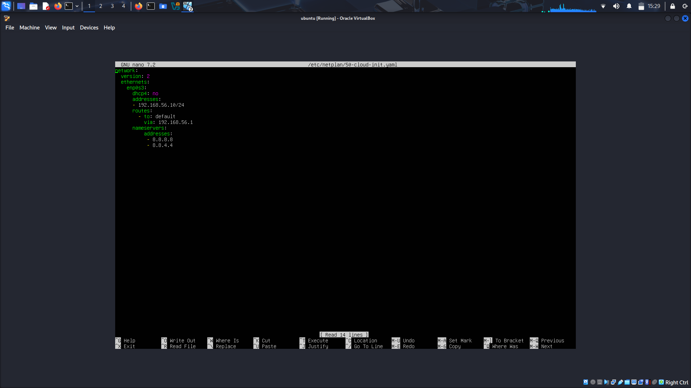
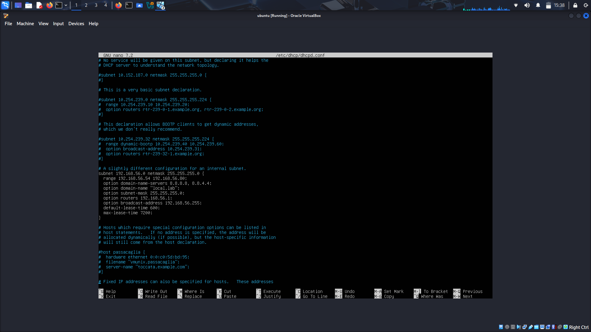
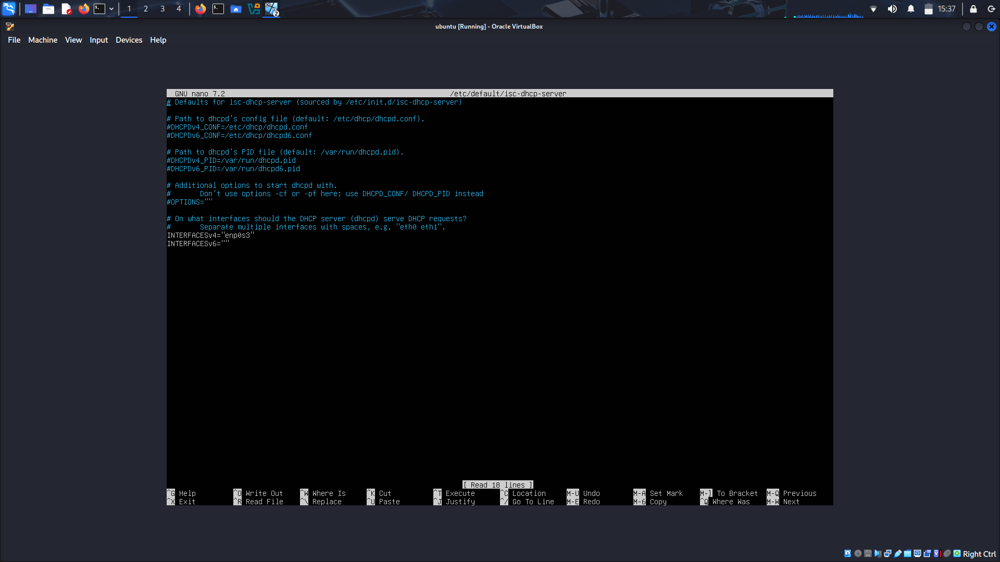
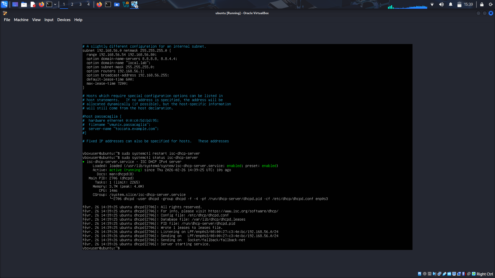
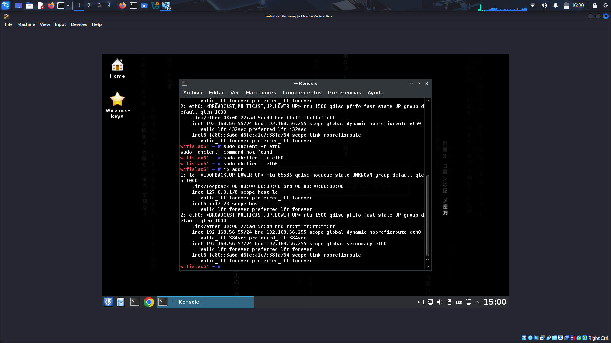
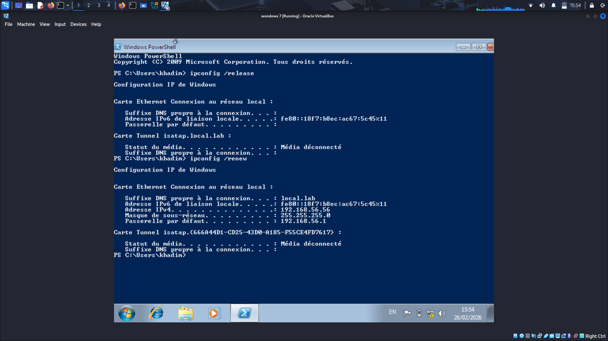
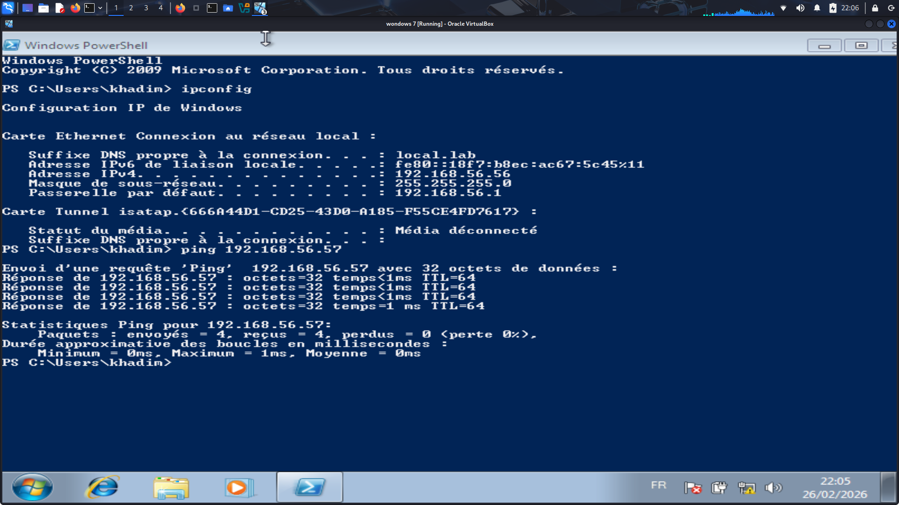

# Serveur DHCP sous Ubuntu Server

Lab réalisé le 26 février 2026 sous VirtualBox : un serveur DHCP (ISC DHCP Server) sur Ubuntu Server distribue automatiquement des adresses IP à deux clients, Wifislax et Windows 7, dans un réseau Host-Only.

**Auteur :** Khadim Mbacké Thiao
**Réseau :** Host-Only 192.168.56.0/24, isolé d’Internet
**Outils :** Netplan, isc-dhcp-server, `dhclient`, `ipconfig`

| Machine | Système | Rôle | Adresse IP |
|---|---|---|---|
| Serveur | Ubuntu Server | Serveur DHCP | 192.168.56.10 (statique) |
| Passerelle | VirtualBox Host-Only | Passerelle | 192.168.56.1 |
| Client 1 | Wifislax | Client DHCP | Dynamique |
| Client 2 | Windows 7 | Client DHCP | Dynamique |

## Objectif

Comprendre comment un serveur DHCP attribue automatiquement une adresse IP, un masque, une passerelle et un DNS aux machines d’un réseau, et valider le résultat depuis deux systèmes clients différents.

## 1. IP statique du serveur (Netplan)

Le serveur DHCP doit avoir une adresse fixe : avec une adresse dynamique, les clients ne sauraient pas vers quelle machine envoyer leurs requêtes. J’ai d’abord relevé le nom de l’interface avec `ip a` (ici `enp0s3`, il varie selon les machines), puis modifié le fichier Netplan.

```bash
sudo nano /etc/netplan/50-cloud-init.yaml
sudo netplan apply
```

```yaml
network:
  version: 2
  ethernets:
    enp0s3:
      dhcp4: no
      addresses:
        - 192.168.56.10/24
      routes:
        - to: default
          via: 192.168.56.1
      nameservers:
        addresses:
          - 8.8.8.8
          - 8.8.4.4
```

`addresses` définit l’IP statique, `routes` la passerelle par défaut et `nameservers` les DNS.


*Fichier Netplan du serveur*

## 2. Installation du serveur DHCP

```bash
sudo apt update
sudo apt install isc-dhcp-server
```

Juste après l’installation, le service est inactif ou en erreur : c’est normal, il n’est pas encore configuré.

## 3. Configuration du service

Le fichier `/etc/dhcp/dhcpd.conf` déclare le sous-réseau et les paramètres donnés aux clients.

```
subnet 192.168.56.0 netmask 255.255.255.0 {
  range 192.168.56.54 192.168.56.80;
  option domain-name-servers 8.8.8.8, 8.8.4.4;
  option domain-name "local.lab";
  option subnet-mask 255.255.255.0;
  option routers 192.168.56.1;
  option broadcast-address 192.168.56.255;
  default-lease-time 600;
  max-lease-time 7200;
}
```

- `range` : plage d’adresses distribuées aux clients (.54 à .80)
- `option routers` et `option domain-name-servers` : passerelle et DNS fournis aux clients
- `default-lease-time` et `max-lease-time` : durée d’attribution d’une adresse, en secondes (10 minutes par défaut, 2 heures au maximum)


*Bloc subnet dans dhcpd.conf*

Il faut aussi dire au service sur quelle interface écouter, dans `/etc/default/isc-dhcp-server` :

```
INTERFACESv4="enp0s3"
```


*Interface d’écoute du service*

## 4. Démarrage et vérification

```bash
sudo systemctl restart isc-dhcp-server
sudo systemctl status isc-dhcp-server
```

Le service passe à `active (running)` et écoute sur `enp0s3` pour le réseau 192.168.56.0/24. S’il reste `failed`, il y a une erreur dans la configuration à corriger.


*Service isc-dhcp-server actif*

## 5. Tests côté clients

**Wifislax :** `sudo dhclient -r eth0` libère l’adresse, `sudo dhclient eth0` en demande une nouvelle, puis `ip addr` la vérifie. Le client reçoit 192.168.56.55, dans la plage attendue.


*Wifislax : adresse obtenue par DHCP*

**Windows 7 :** `ipconfig /release` supprime l’adresse IPv4, puis `ipconfig /renew` en obtient une du serveur : 192.168.56.56, masque 255.255.255.0, passerelle 192.168.56.1 et suffixe DNS `local.lab`.


*Windows 7 : release puis renew*

**Connectivité :** depuis Windows 7, `ping 192.168.56.57` répond (4 paquets reçus, 0 perdu), donc les deux clients communiquent bien sur le réseau Host-Only.


*Ping de Windows 7 vers Wifislax*

## Fonctionnement du protocole : DORA

1. **Discover** : le client envoie en broadcast (255.255.255.255) une demande de serveur DHCP, car il n’a pas encore d’adresse.
2. **Offer** : le serveur propose une adresse et les paramètres réseau, de façon temporaire.
3. **Request** : le client accepte l’offre, ce qui confirme aussi le serveur choisi s’il y en a plusieurs.
4. **Acknowledge** : le serveur confirme l’attribution, et le client peut utiliser son adresse.

## Problèmes rencontrés et remarques

- **Service en erreur après l’installation** : normal, aucune configuration n’existait encore. Il démarre une fois `dhcpd.conf` et l’interface renseignés.
- **`dhclient: command not found` sur Wifislax** : la première commande a échoué, puis la relance a fonctionné.
- **Wifislax affiche deux adresses** : 192.168.56.55 (dynamique) et 192.168.56.57 (secondaire). La commande `dhclient` a été lancée plusieurs fois, ce qui a probablement ajouté une seconde adresse. C’est l’adresse .57 qui est utilisée pour le ping depuis Windows 7.

## Compétences mobilisées

- Configuration d’une IP statique avec Netplan
- Installation et configuration d’un serveur DHCP sous Linux
- Définition d’une plage, de baux, d’une passerelle et d’un DNS
- Validation depuis des clients Linux et Windows (`dhclient`, `ipconfig`)
- Compréhension du cycle DORA

## Pistes d’amélioration

- Réserver une adresse fixe à une machine avec une déclaration `host` (adresse MAC)
- Capturer l’échange DORA avec Wireshark pour le voir en pratique
- Fournir un DNS interne plutôt que les DNS publics de Google
