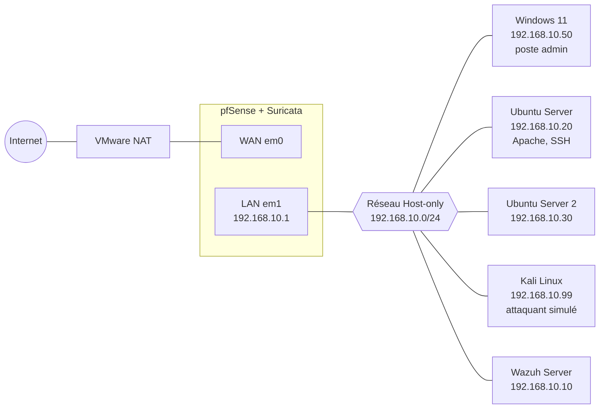

# Labs Sécurité Réseau : pfSense, Suricata et Wazuh

Documentation d'une série de travaux pratiques de sécurité réseau réalisés en laboratoire virtuel (VMware).
Le fil conducteur : sécuriser le réseau d'une entreprise fictive, **TechSenegal SA**, avec un pare-feu,
un système de détection et de prévention d'intrusion, puis un SIEM.

- **Auteur** : Khadim Mbacké Thiao
- **Cadre** : cours *Sécurité réseau* (ISM, 2026). Les sujets de TP sont de **Abdoul Haatii SARR**.
- **Contenu** : ce dépôt documente ce qui a été réellement réalisé, avec les captures d'écran, les
  problèmes rencontrés et leurs corrections. Les textes sont rédigés par l'auteur et ne reproduisent pas les sujets.

> Toutes les attaques (scans, brute force, C2) sont simulées **dans un réseau isolé** entre machines virtuelles
> appartenant à l'auteur. N'utilisez jamais ces techniques contre des systèmes sans autorisation.

## Architecture du laboratoire



| Machine | Rôle | Adresse IP | Réseau VMware |
|---|---|---|---|
| pfSense CE | Pare-feu, routeur, NAT, IDS/IPS Suricata | LAN 192.168.10.1, WAN en DHCP | NAT (WAN) + Host-only (LAN) |
| Windows 11 | Poste administrateur | 192.168.10.50 (fixe) | Host-only |
| Ubuntu Server | Serveur web Apache et SSH, cible des attaques | 192.168.10.20 (fixe) | Host-only |
| Kali Linux | Machine d'attaque simulée | 192.168.10.99 (fixe) | Host-only |
| Wazuh Server | SIEM (manager, indexer, dashboard) | 192.168.10.10 (réservation DHCP) | Host-only |
| Ubuntu Server 2 | Clone d'Ubuntu Server, 3e agent Wazuh | 192.168.10.30 (fixe) | Host-only |

Le DHCP de pfSense distribue les adresses de `192.168.10.100` à `192.168.10.200`. Le DHCP intégré de VMware
est désactivé sur le réseau Host-only pour éviter un conflit.

Versions : pfSense CE (installé avec le Netgate Installer v1.2), Suricata 8.0.7, Wazuh 4.14.x (agents en 4.14.10).

## Les TP

| # | Sujet | Ce qui est démontré | Documentation |
|---|---|---|---|
| 1 | Installation de pfSense | VM pfSense avec deux cartes, assistant de configuration, tests de connectivité WAN, LAN et DNS | [docs/01-installation-pfsense.md](docs/01-installation-pfsense.md) |
| 2 | Filtrage avancé et NAT | Alias, règles LAN ordonnées, Port Forward, planification horaire, lecture des logs | [docs/02-filtrage-et-nat.md](docs/02-filtrage-et-nat.md) |
| 4 | Règles Suricata (IDS) | 5 règles de détection testées depuis Kali, plus deux règles écrites en autonomie | [docs/03-regles-suricata-ids.md](docs/03-regles-suricata-ids.md) |
| 5 | Suricata en mode IPS | Blocage automatique, Pass List, faux positifs, mode inline, confinement d'une machine | [docs/04-suricata-ips.md](docs/04-suricata-ips.md) |
| 6 | SIEM Wazuh | Agents Ubuntu et Windows, logs pfSense en Syslog, inventaire, rapport PDF | [docs/05-wazuh-siem.md](docs/05-wazuh-siem.md) |

La numérotation reprend celle du cours : il n'y a pas de TP 3 dans cette série.

## Résultats principaux

- Politique de filtrage **deny-all** avec exceptions minimales, et un poste admin seul autorisé sur le WebGUI.
- Machine d'attaque isolée par une règle de blocage placée au bon endroit dans l'ordre des règles.
- Port Forward `8080 -> 80` et `9443 -> 8443` fonctionnels, avec journalisation.
- **7 règles de détection personnalisées** (ping sweep, scan SYN, brute force SSH, scanner web, port C2, DNS, Telnet).
- Passage de la détection au **blocage** : `"action":"blocked"` observé dans les logs EVE en mode inline.
- Confinement d'un serveur « compromis » : DNS et web autorisés, tout le reste supprimé.
- **3 agents Wazuh** actifs, logs pfSense reçus en Syslog, premier rapport de sécurité généré ([PDF](reports/wazuh-threat-hunting-report.pdf)).

## Problèmes rencontrés (résumé)

Le détail, avec les captures, est dans chaque page de documentation.

| Sujet | Cause | Correction |
|---|---|---|
| Kali atteignait encore le WebGUI malgré une règle Block | Règle « Pass web » placée avant le Block, et Anti-Lockout Rule | Block remonté en tête, Anti-Lockout désactivée, états réinitialisés |
| `apt update` échouait sur Ubuntu | La planification horaire coupait la navigation hors 8h-18h | Planification retirée le temps de l'installation |
| Une règle Suricata modifiée n'était pas prise en compte | Le bouton Restart ne rechargeait pas le moteur | Stop puis Start de l'interface |
| Nikto n'était pas détecté | Nikto 2.6.0 se présente avec un User-Agent de navigateur | Règle validée avec `curl -A "Nikto"` |
| Kali jamais bloqué en mode IPS | La Pass List contenait tout le réseau local | Option « Local Networks » décochée |
| Ubuntu bloqué par erreur | Règle intégrée `ICMPv4 unknown code` | IP ajoutée à la Pass List |
| Agent Wazuh connecté à la mauvaise IP | Adresse du manager mal saisie dans la commande générée | Adresse corrigée en `192.168.10.10` |

## Structure du dépôt

```
.
├── README.md
├── docs/            une page par TP
├── images/          captures d'écran classées par TP
├── configs/
│   ├── suricata/    custom.rules (état final)
│   ├── wazuh/       extrait de ossec.conf
│   └── ubuntu/      configuration réseau Netplan
└── reports/         rapport PDF généré par Wazuh
```

## Compétences mises en pratique

Administration de pare-feu (règles, NAT, alias, planification), segmentation et adressage IP, lecture de logs,
écriture de signatures IDS/IPS, gestion des faux positifs, déploiement et supervision d'un SIEM, dépannage méthodique.
