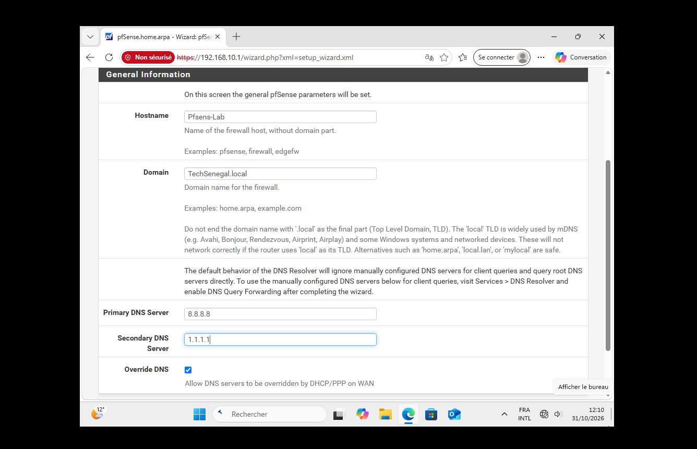
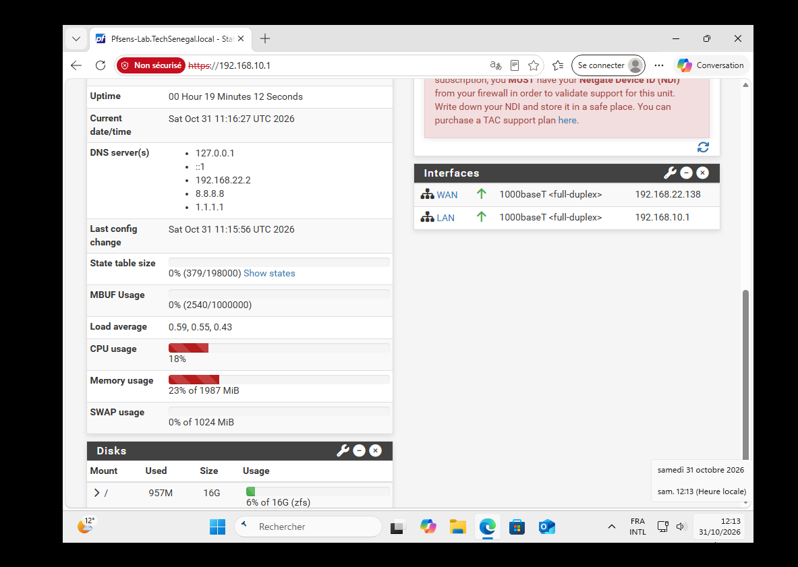
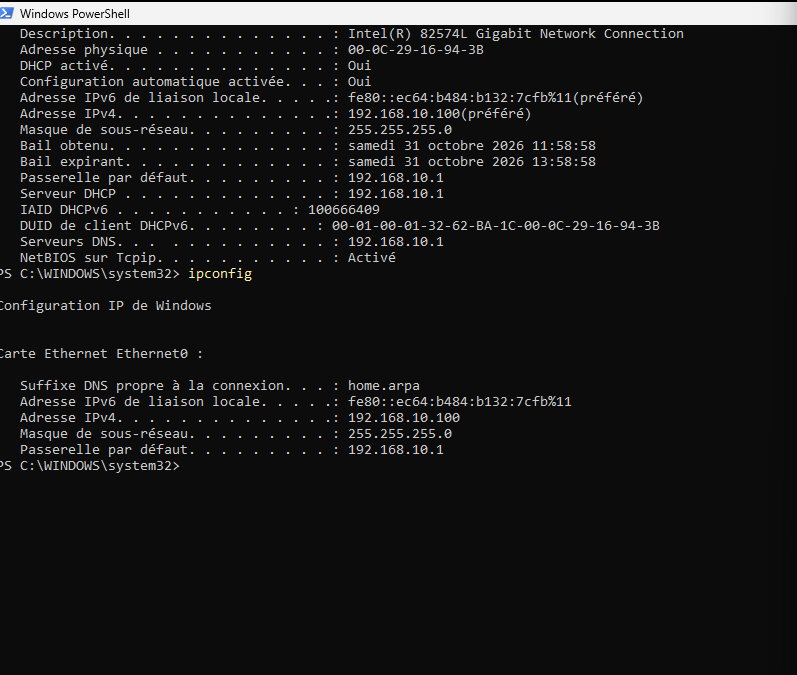
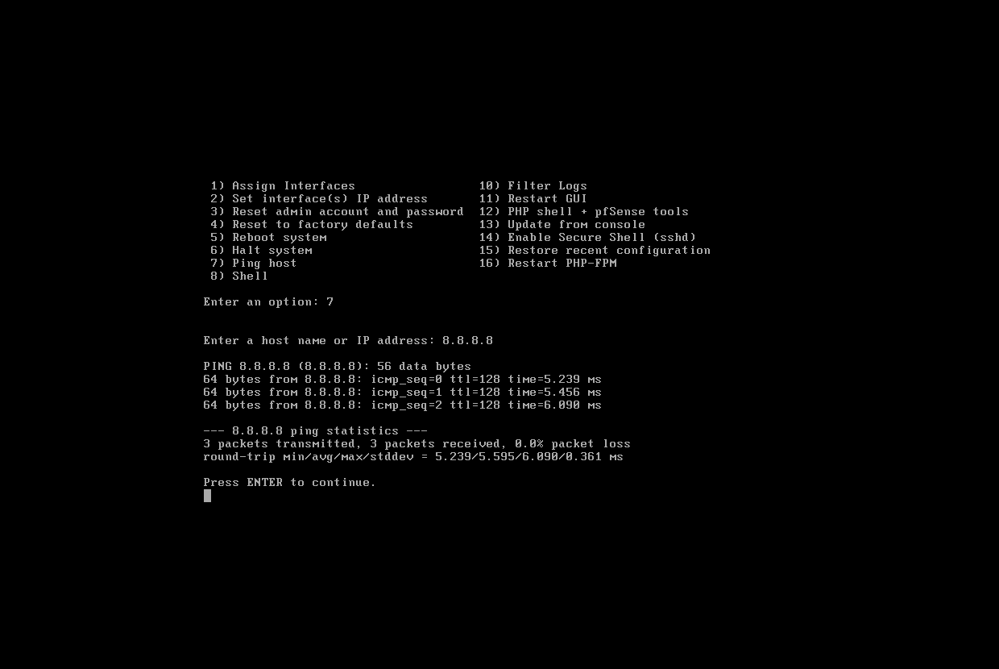
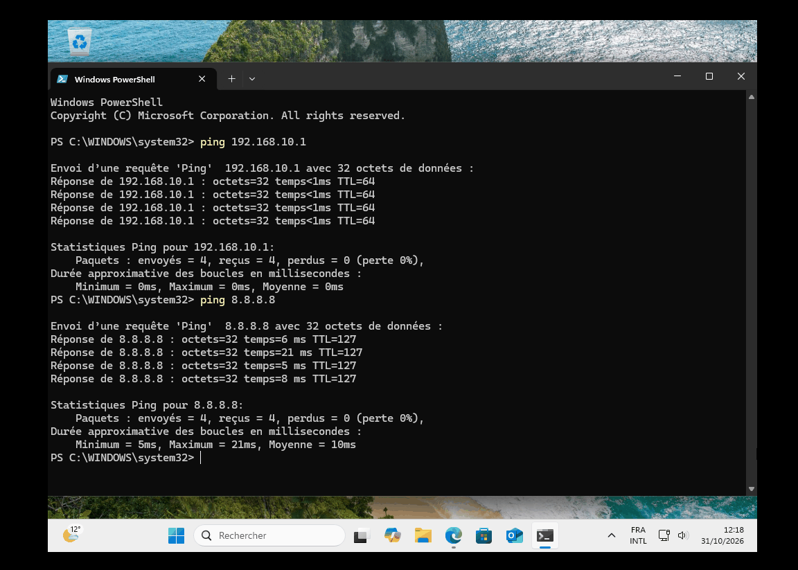
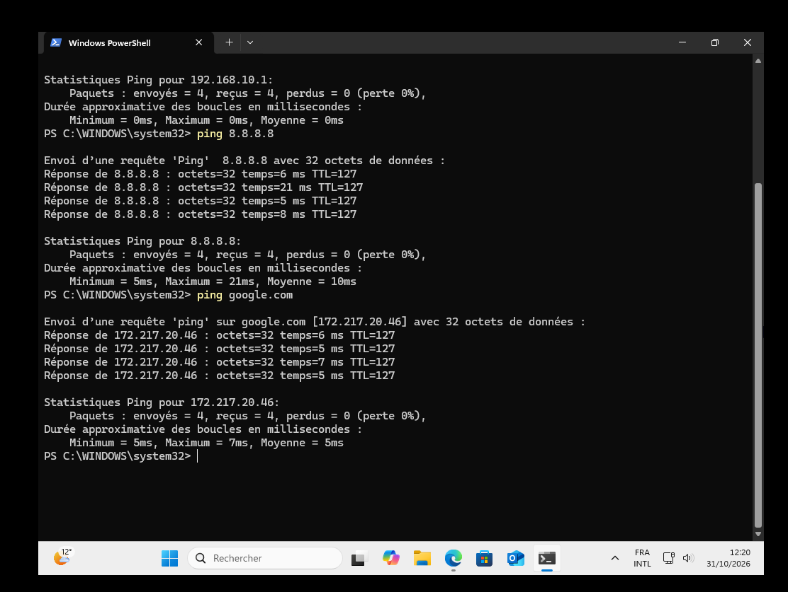

# TP 1 : Installation et configuration de pfSense

[← Retour au sommaire](../README.md)

## Objectif

Mettre en place un pare-feu open source pour **TechSenegal SA** : créer la machine virtuelle, installer pfSense,
configurer le WAN et le LAN, accéder à l'interface web et vérifier la connectivité de bout en bout.

pfSense est un système basé sur FreeBSD qui joue les rôles de pare-feu, de routeur et de serveur DHCP.
Il filtre le trafic selon des règles, partage la connexion Internet par NAT et se gère depuis un navigateur.

## Architecture

| Élément | Valeur |
|---|---|
| WAN (em0) | Carte VMware **NAT**, adresse reçue en DHCP |
| LAN (em1) | Carte VMware **Host-only**, `192.168.10.1/24` |
| DHCP du LAN | `192.168.10.100` à `192.168.10.200` |
| Client de test | Windows 11 en Host-only |

## Étapes réalisées

### 1. Préparer VMware

- Création d'une VM **FreeBSD 64-bit** : 1 Go de RAM, 1 vCPU, disque de 20 Go.
- Deux cartes réseau : la première en **NAT** (WAN), la seconde en **Host-only** (LAN).
- Dans le *Virtual Network Editor*, désactivation du **DHCP intégré de VMware** sur le réseau Host-only. Sinon deux serveurs
  DHCP se disputent le même réseau que pfSense.
- Le sous-réseau du Host-only est réglé sur `192.168.50.0/24`, pour que la carte virtuelle de l'hôte ne prenne pas
  `192.168.10.1`, l'adresse de pfSense.

### 2. Installer pfSense

L'ISO utilisée est celle du **Netgate Installer** (`netgate-installer-v1.2-RELEASE-amd64.iso`, version pour machines
virtuelles). Le « 1.2 » est la version de l'installeur, pas celle de pfSense : il installe pfSense CE.

Choix effectués pendant l'installation :

| Écran | Choix |
|---|---|
| Interfaces | WAN = `em0` (NAT), LAN = `em1` (Host-only) |
| Réseau du LAN | Statique, `192.168.10.1/24`, DHCP activé de `.100` à `.200` |
| Édition | **Install CE** (version gratuite) |
| Système de fichiers | ZFS, schéma GPT, mode *stripe* (pas de redondance, suffisant en lab) |

Avant le redémarrage, le lecteur CD/DVD de la VM est **déconnecté** : sinon la VM relance l'installeur au lieu de
démarrer sur le disque.

### 3. Configurer pfSense depuis le navigateur

Depuis la VM Windows (en Host-only), accès à `https://192.168.10.1`. L'avertissement de certificat est normal : le
certificat est auto-signé.

Réglages dans **System > General Setup** :

- domaine `TechSenegal.local` ;
- DNS `8.8.8.8` et `1.1.1.1` ;
- fuseau horaire (`Africa/Dakar` au départ, changé plus tard en `Europe/Paris` pour aligner les heures avec la VM) ;
- changement du mot de passe administrateur par défaut.

### 4. Vérifier les interfaces

Dans **Status > Interfaces** et sur le tableau de bord : WAN et LAN sont **up**, le LAN porte `192.168.10.1`.

### 5. Tests de connectivité

Le client Windows a bien reçu une adresse du DHCP de pfSense, avec pfSense pour passerelle et pour serveur DHCP.

Test depuis la console de pfSense (option 7, *Ping host*) vers `8.8.8.8` : le WAN a accès à Internet.

Tests depuis le client Windows, dans l'ordre :

| Test | Commande | Ce que ça vérifie | Résultat |
|---|---|---|---|
| Adresse du client | `ipconfig` | Le DHCP de pfSense fonctionne | OK |
| Passerelle | `ping 192.168.10.1` | Le LAN est opérationnel | OK |
| Internet | `ping 8.8.8.8` | Le NAT et le WAN fonctionnent | OK |
| DNS | `ping google.com` | La résolution de noms fonctionne | OK |

## Problèmes rencontrés

| Problème | Explication | Ce que j'en retiens |
|---|---|---|
| L'écran d'installation affichait « v1.2-RELEASE » alors que je cherchais pfSense 2.7 | C'est la version du Netgate Installer, qui télécharge pfSense CE | Lire le nom exact de l'ISO avant de conclure à un mauvais téléchargement |
| Deux serveurs DHCP possibles sur le Host-only | Le DHCP intégré de VMware reste actif par défaut | Le désactiver dans le Virtual Network Editor |
| Une réinstallation de test s'est terminée sur l'invite `mountroot>` (système racine introuvable) | Cause non identifiée | Prendre un **snapshot après chaque TP** pour pouvoir revenir en arrière |
| Les écrans de l'installeur ne ressemblaient pas à ceux décrits dans le sujet | Le Netgate Installer remplace l'installeur classique et pose lui-même les questions WAN, LAN et DHCP | Comprendre l'objectif de chaque écran plutôt que suivre le sujet à la lettre |

## À retenir

- WAN et LAN ne se confondent pas : la carte **NAT** sert d'accès Internet, la **Host-only** forme le réseau interne.
- Un seul serveur DHCP par réseau : celui de pfSense.
- Les snapshots VMware sont le filet de sécurité de tout le projet.
