# TP 4 : Règles de détection personnalisées avec Suricata (mode IDS)

[← Retour au sommaire](../README.md)

## Objectif

Les règles communautaires de Suricata ne couvrent pas tous les besoins de TechSenegal SA. Ce TP consiste à écrire,
tester et ajuster des règles sur mesure pour détecter :

- un balayage de pings (*ping sweep*) et un scan de ports ;
- une attaque par force brute sur SSH ;
- un scanner web ;
- du trafic vers un port de commande et contrôle (C2) ;
- deux menaces supplémentaires données en défi : l'exfiltration DNS et Telnet.

Suricata fonctionne ici en **IDS** : il observe et alerte, sans bloquer. Le blocage fait l'objet du [TP 5](04-suricata-ips.md).

## Installation et réglages

1. Installation du paquet **Suricata** depuis **System > Package Manager**.
2. **Services > Suricata > Global Settings** : activation des règles **ETOpen Emerging Threats**, puis mise à jour des règles.
3. Ajout de l'interface **LAN** (`em1`) dans **Services > Suricata > Interfaces**, avec :
   - l'envoi des alertes au journal système ;
   - le journal **EVE JSON** (format lu par les SIEM, utilisé avec Wazuh au TP 6) ;
   - l'option **Block Offenders désactivée** (mode IDS).
4. Désactivation de trois fonctions de la carte réseau virtuelle (*checksum offload*, *TCP segmentation offload*,
   *large receive offload*) dans **System > Advanced > Networking**. Suricata l'exige et affiche un avertissement sinon.

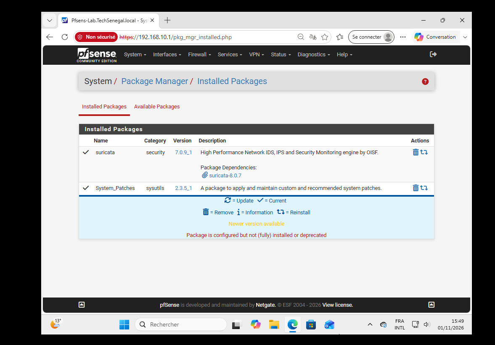

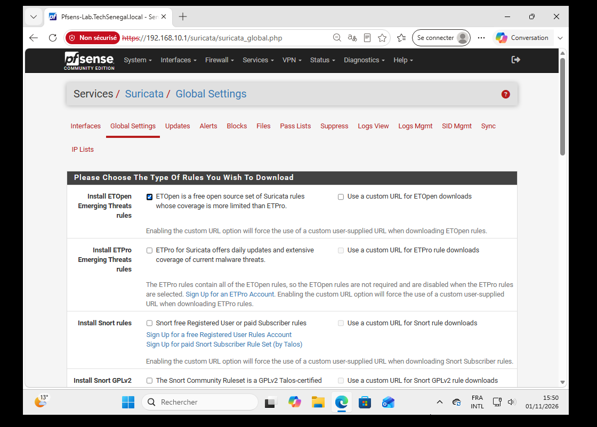

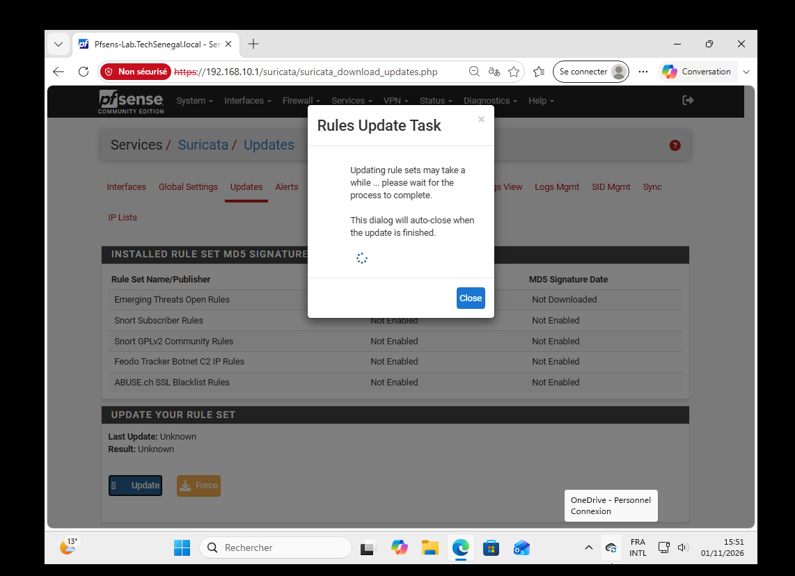

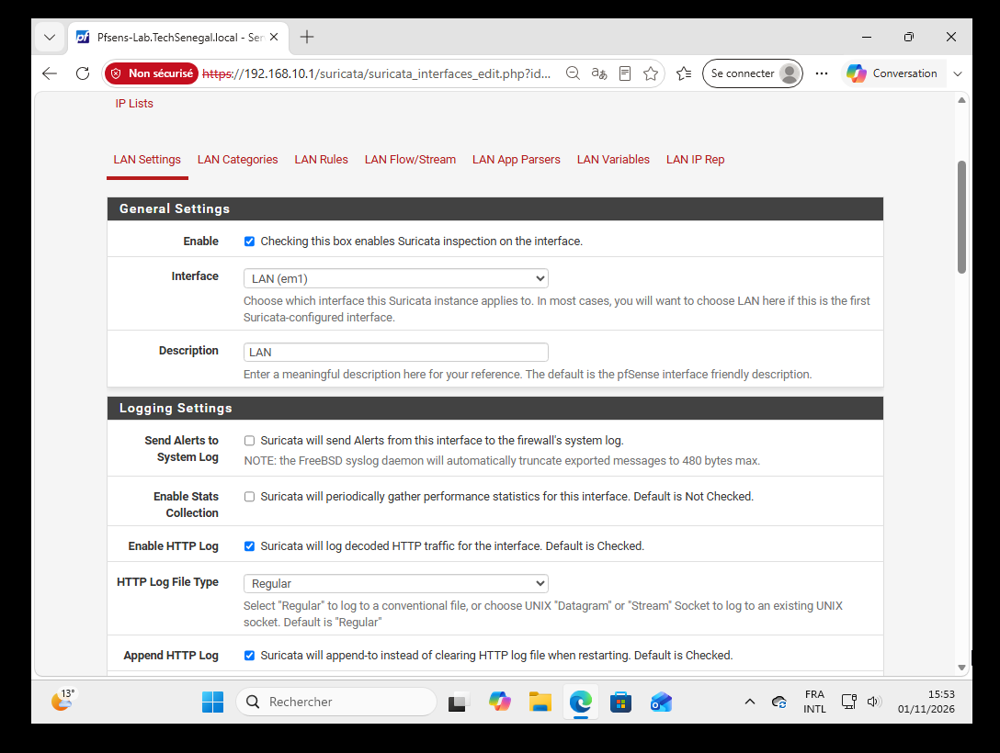

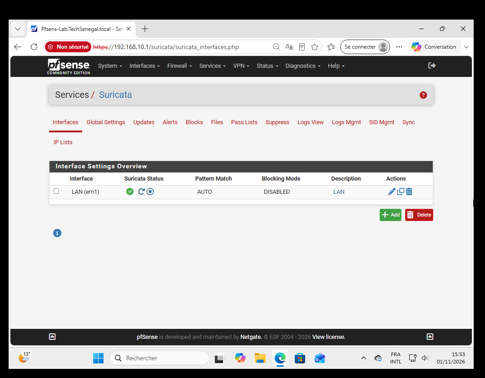

## Anatomie d'une règle

```
alert tcp any any -> $HOME_NET 22 (msg:"Tentative SSH"; sid:1000001; rev:1;)
```

| Morceau | Sens |
|---|---|
| `alert` | Action : générer une alerte (en IPS, `drop` supprime le paquet) |
| `tcp` | Protocole (`tcp`, `udp`, `icmp`, `http`, `dns`...) |
| `any any` | Source : adresse puis port |
| `->` | Sens de la conversation |
| `$HOME_NET 22` | Destination : le réseau interne (variable), port 22 |
| `msg` | Texte affiché dans l'alerte |
| `sid` | Identifiant unique (plage 1000000+ pour les règles locales) |
| `rev` | Numéro de version de la règle, augmenté à chaque modification |
| `threshold` | Seuil : n'alerter qu'après N événements en X secondes, par source |

Les règles se saisissent dans **Services > Suricata > Interfaces > LAN > LAN Rules**, en choisissant la catégorie
`custom.rules` dans la liste déroulante. Le fichier final est dans [`configs/suricata/custom.rules`](../configs/suricata/custom.rules).

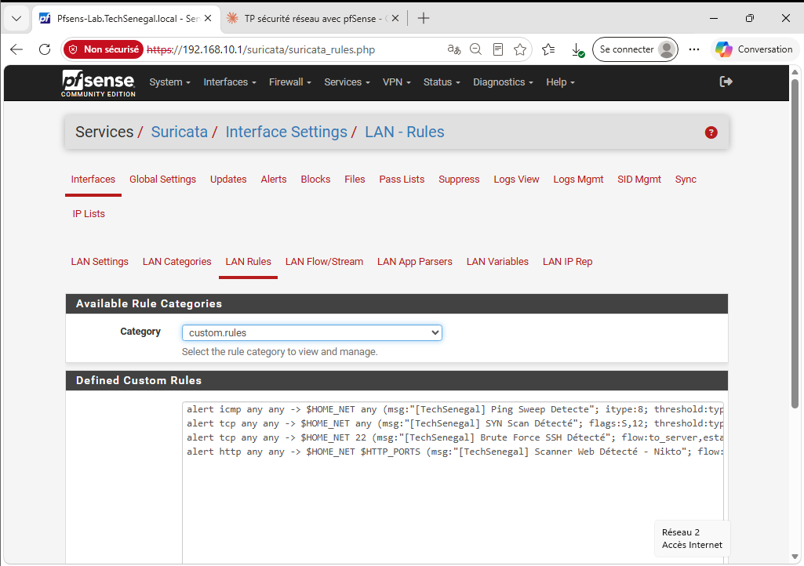

## Les règles et leurs tests

### Règle 1 (SID 1000001) : ping sweep

```
alert icmp any any -> $HOME_NET any (msg:"[TechSenegal] Ping Sweep Détecté"; itype:8; threshold:type threshold,track by_src,count 10,seconds 5; classtype:attempted-recon; sid:1000001; rev:1;)
```

Alerte quand une même source envoie 10 pings (`itype:8`, *echo request*) en 5 secondes vers le réseau interne.
Test depuis Kali : `nmap -sn 192.168.10.0/24`, puis `ping -c 20 -i 0.1 192.168.10.20`.

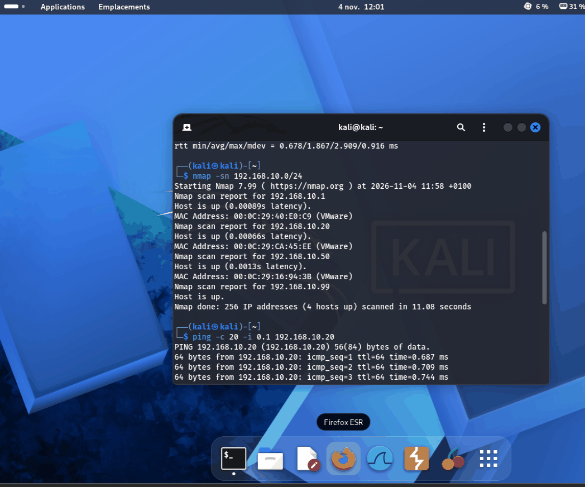

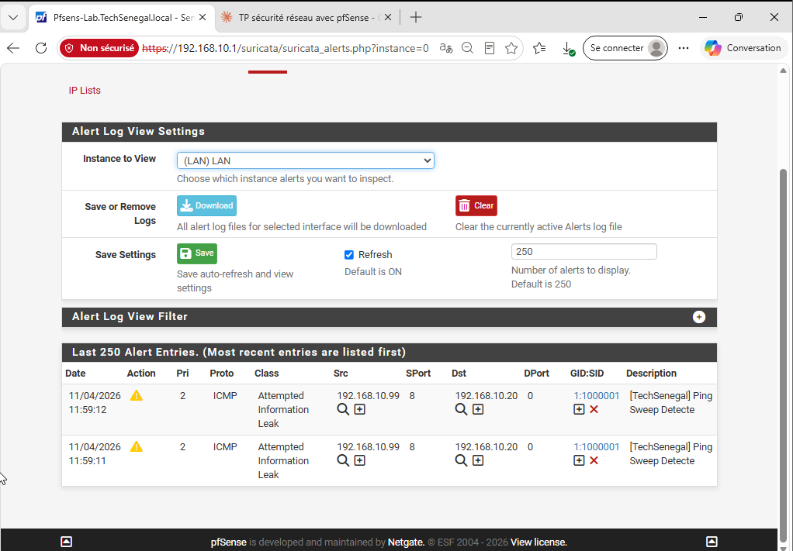

### Règle 2 (SID 1000002) : scan de ports SYN

```
alert tcp any any -> $HOME_NET any (msg:"[TechSenegal] SYN Scan Détecté"; flags:S,12; threshold:type threshold,track by_src,count 20,seconds 10; classtype:attempted-recon; sid:1000002; rev:1;)
```

Un scan SYN envoie des paquets TCP avec le seul drapeau SYN vers de nombreux ports, sans terminer la connexion. Vingt SYN en dix
secondes depuis une même source révèlent ce comportement. Test : `sudo nmap -sS 192.168.10.20`.

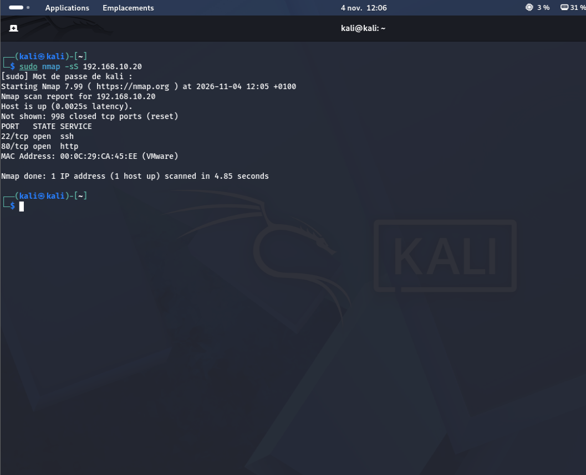

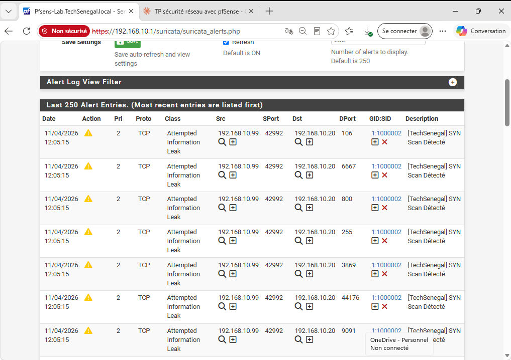

### Règle 3 (SID 1000003) : force brute SSH

```
alert tcp any any -> $HOME_NET 22 (msg:"[TechSenegal] Brute Force SSH Détecté"; flow:to_server,established; content:"SSH"; depth:4; threshold:type threshold,track by_src,count 5,seconds 30; classtype:attempted-admin; sid:1000003; rev:1;)
```

Chaque tentative de mot de passe ouvre une connexion vers le port 22 ; le client annonce « SSH » dans les quatre premiers octets.
Cinq connexions en 30 secondes depuis la même source déclenchent l'alerte. Il a fallu installer `openssh-server` sur Ubuntu Server.
Test : `hydra -l ubuntu -P <liste de mots de passe> ssh://192.168.10.20 -t 4 -V`.

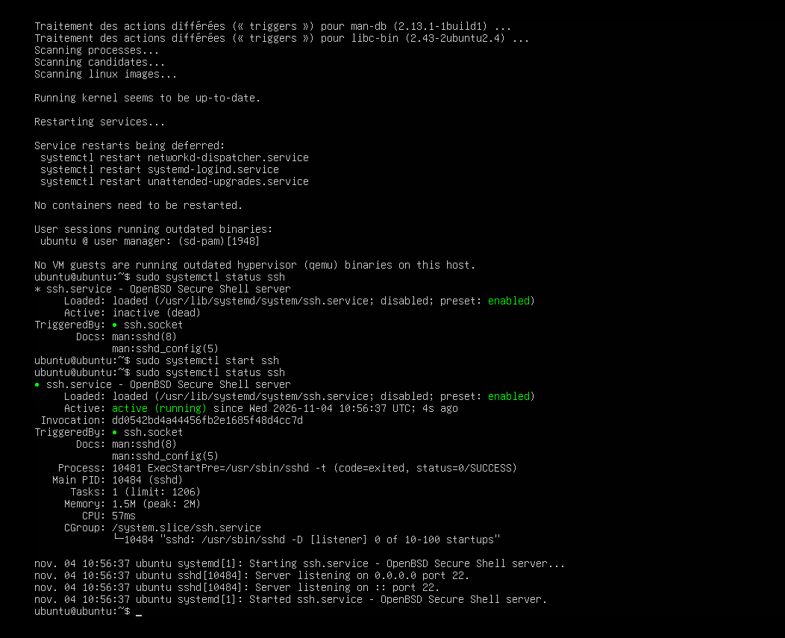

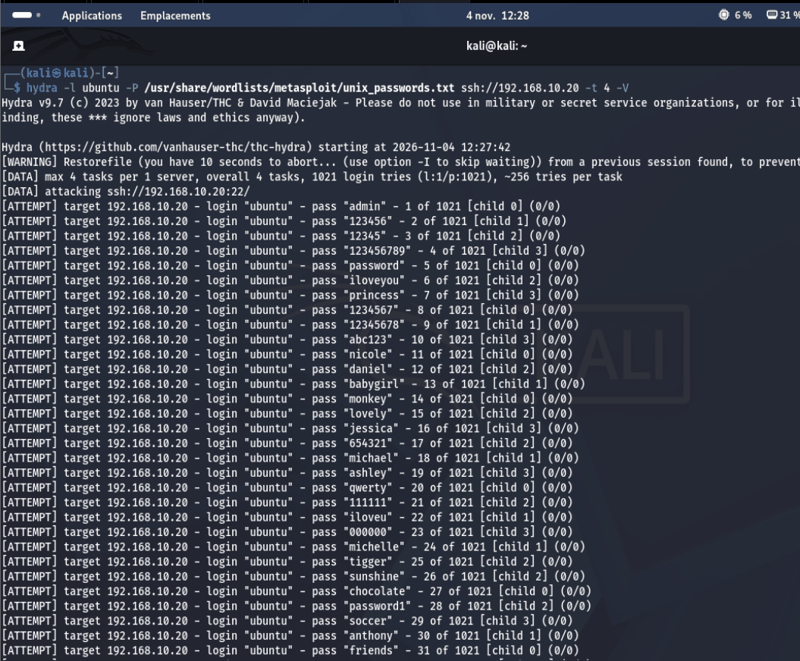

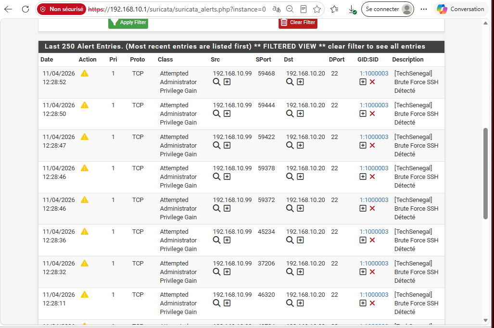

### Règle 4 (SID 1000004) : scanner web Nikto

```
alert http any any -> $HOME_NET $HTTP_PORTS (msg:"[TechSenegal] Scanner Web Détecté - Nikto"; flow:to_server,established; http.user_agent; content:"Nikto"; nocase; classtype:web-application-attack; sid:1000004; rev:1;)
```

La règle inspecte l'en-tête **User-Agent** des requêtes HTTP. **Résultat : aucune alerte avec `nikto -h`.** Le journal HTTP de
Suricata montre que Nikto 2.6.0 se présente avec le User-Agent d'un navigateur (Safari sur iPhone, Chrome sur Linux) et non plus avec
son nom. La règle est correcte : elle se déclenche avec `curl -A "Nikto" http://192.168.10.20`.

Limite à retenir : identifier un outil par son User-Agent est facile à contourner, l'attaquant peut le modifier.

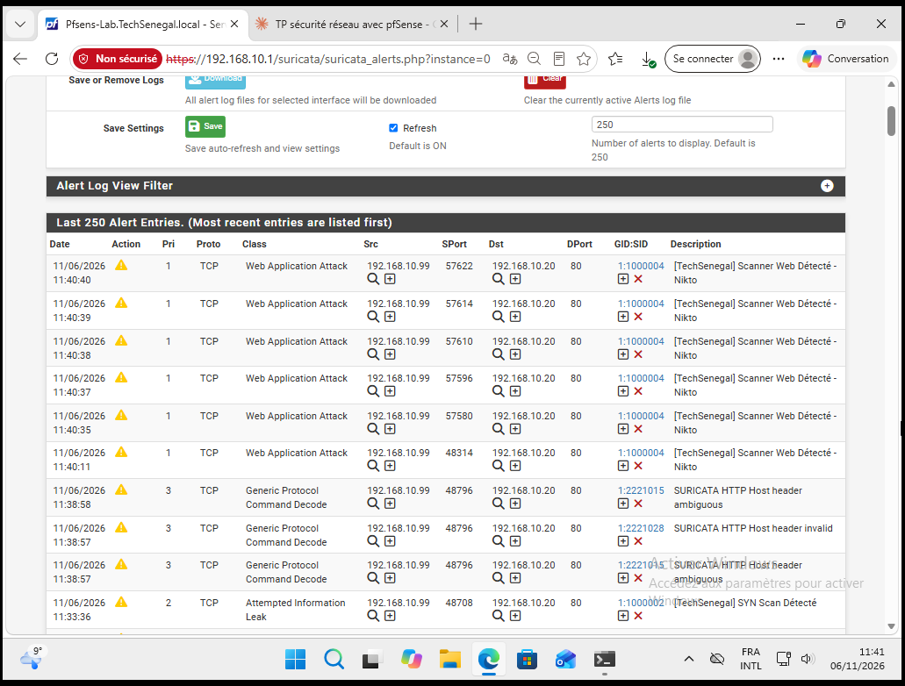

### Règle 5 (SID 1000005) : trafic vers le port C2 4444

```
alert tcp $HOME_NET any -> $EXTERNAL_NET 4444 (msg:"[TechSenegal] Trafic C2 Suspecté - Port 4444"; flow:to_server,established; classtype:trojan-activity; priority:1; sid:1000005; rev:1;)
```

Le port 4444 est celui que Meterpreter utilise par défaut. Test : Kali écoute avec `nc -lvp 4444`, Ubuntu se connecte avec
`nc 192.168.10.99 4444`.

**Résultat : aucune alerte** avec la règle du sujet. `$EXTERNAL_NET` désigne tout ce qui n'est pas `$HOME_NET`, or Kali, qui joue le
serveur C2, est dans le LAN. La règle a été adaptée au lab en remplaçant `$EXTERNAL_NET` par `any` (`rev:2`), et l'alerte s'est déclenchée.
Elle fonctionnerait telle quelle avec un vrai serveur sur Internet.

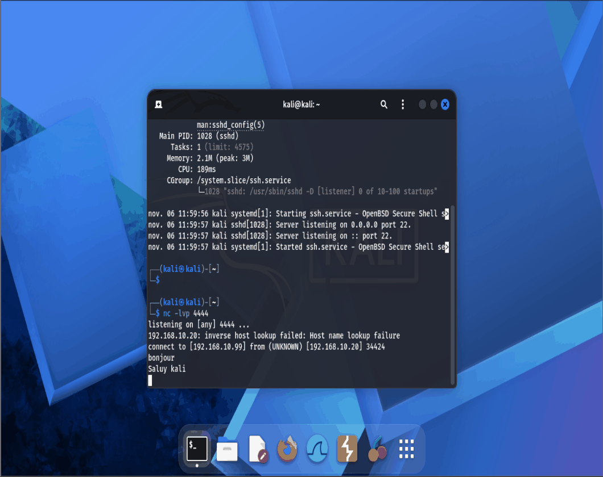

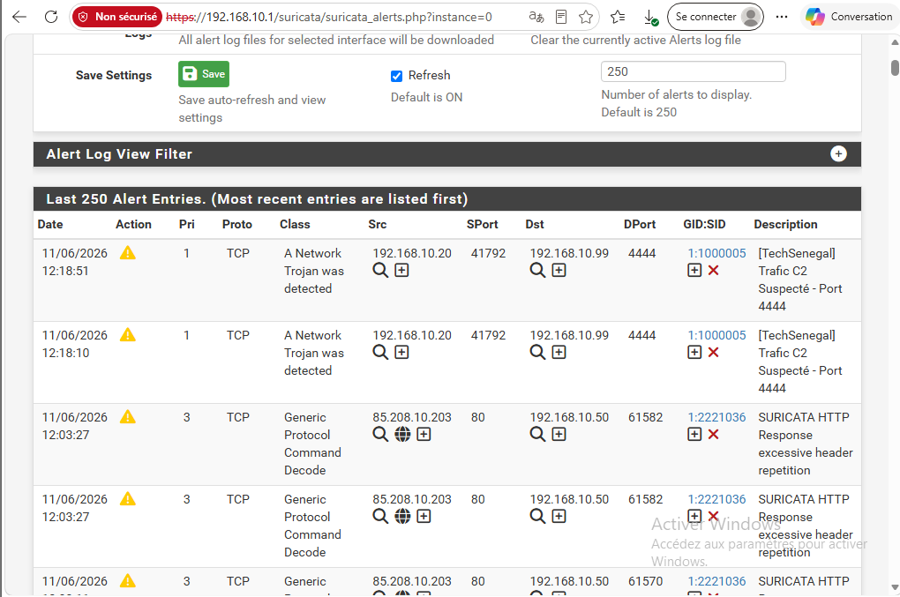

## Lire les alertes

- Dans pfSense : **Services > Suricata > Alerts**, interface LAN (date, source, destination, ports, SID, message).
- Dans le journal **EVE JSON** : une ligne par événement, au format JSON. Le fichier devient très gros après les scans et la page
  **Logs View** ne l'affiche plus ; on l'interroge donc avec **Diagnostics > Command Prompt** :

```
grep '"signature_id":1000003' /var/log/suricata/suricata_em147797/eve.json | tail -n 1
```

(Le nom du dossier `suricata_em147797` dépend de l'interface ; `ls /var/log/suricata/` le donne.)

Une alerte EVE contient notamment `src_ip`, `dest_ip`, `dest_port`, `signature`, `severity` et `alert.action`. En IDS, `action`
vaut `allowed` : le trafic est laissé passer.

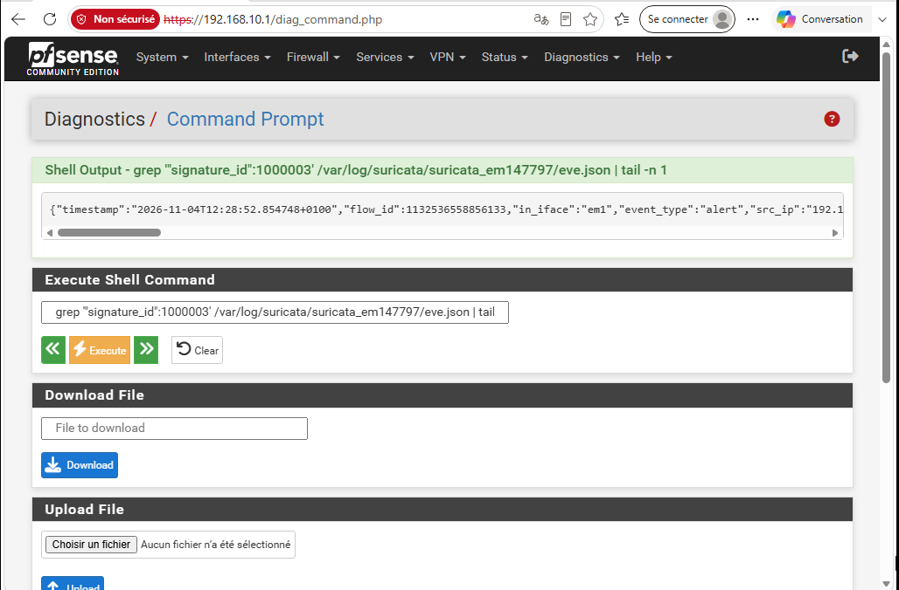

## Réduire les faux positifs

**Exception pour le poste admin** : une règle `pass`, placée **avant** la règle d'alerte, évite que les pings de `192.168.10.50`
déclenchent le ping sweep.

```
pass icmp 192.168.10.50 any -> $HOME_NET any (msg:"Admin Ping Autorisé"; itype:8; sid:1000010; rev:1;)
```

**Seuil SSH assoupli** : de 5 connexions en 30 s à **10 connexions en 60 s**, pour qu'un développeur ouvrant plusieurs sessions
légitimes ne déclenche pas l'alerte. L'alerte reste active face à une attaque.

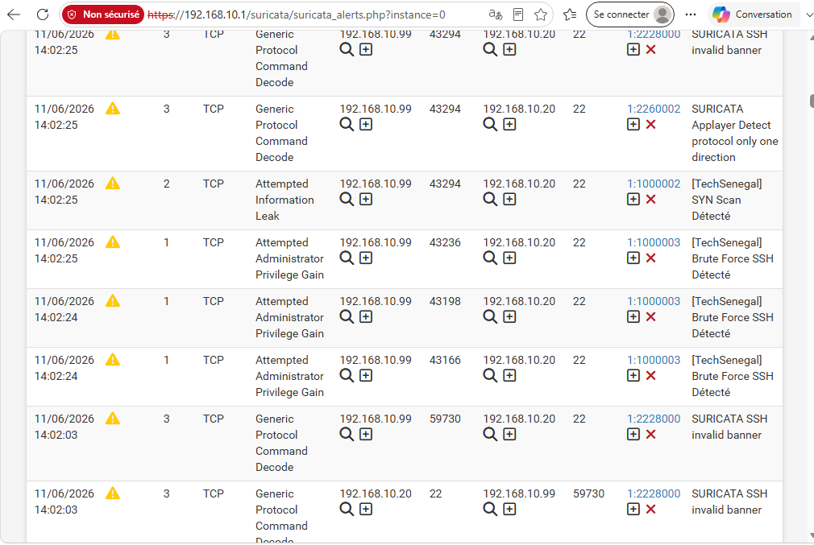

Compromis à garder en tête : un seuil plus haut réduit les faux positifs, mais laisse passer une attaque plus lente.

## Mini-défi : deux menaces à détecter

```
# Exfiltration DNS : volume anormal de requêtes DNS depuis le LAN
alert dns $HOME_NET any -> any 53 (msg:"[TechSenegal] Exfiltration DNS Suspectée"; threshold:type threshold,track by_src,count 30,seconds 10; classtype:bad-unknown; sid:1000020; rev:1;)

# Telnet : protocole en clair, toute tentative est suspecte
alert tcp any any -> $HOME_NET 23 (msg:"[TechSenegal] Connexion Telnet Détectée"; classtype:attempted-admin; priority:1; sid:1000021; rev:1;)
```

Tests depuis Kali : `telnet 192.168.10.20 23` (le SYN suffit, le service n'a pas besoin d'être actif) et une boucle de 50 `nslookup google.com`.
La règle Telnet n'utilise pas `flow:established`, qui exigerait une connexion déjà établie.

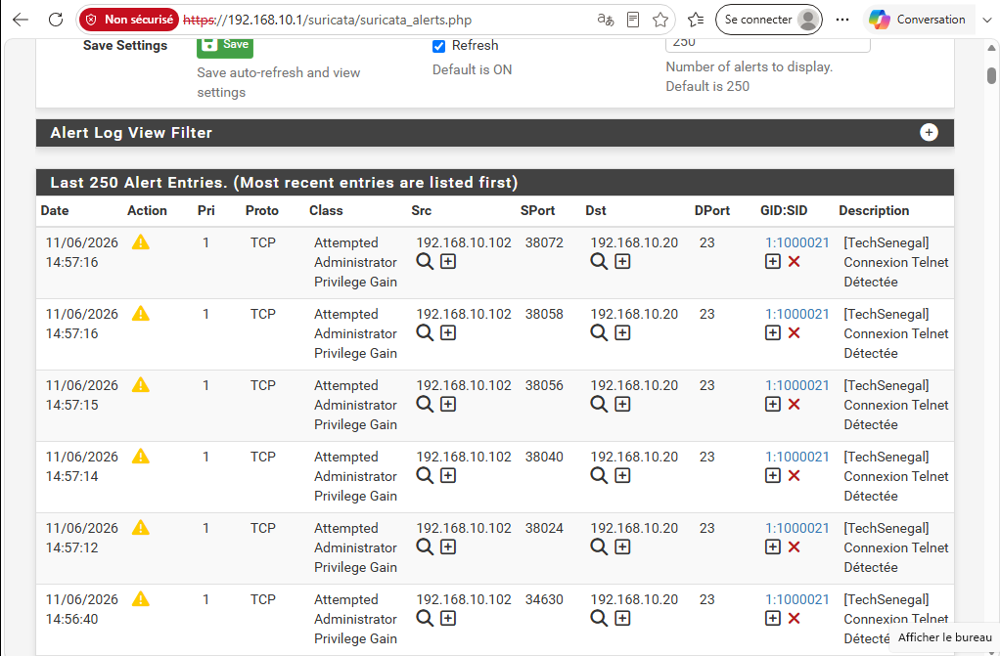

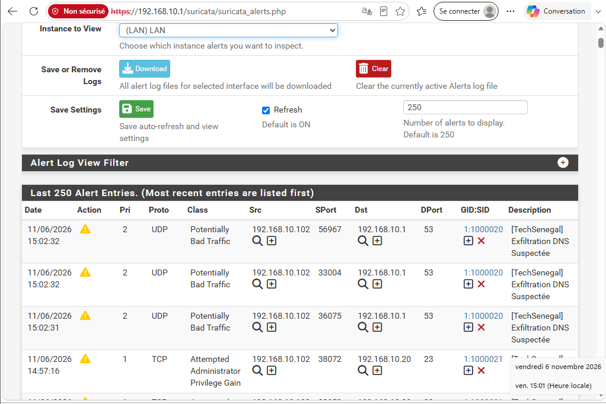

## Tableau de suivi

| Règle | SID | Test | Alerte | Remarque |
|---|---|---|---|---|
| Ping sweep | 1000001 | `nmap -sn`, `ping` rapide | Oui | Après un Stop puis Start de l'interface |
| SYN scan | 1000002 | `nmap -sS` | Oui | Alertes intégrées de Suricata en plus |
| Brute force SSH | 1000003 | Hydra | Oui | Seuil ajusté en fin de TP |
| Scanner Nikto | 1000004 | `nikto`, puis `curl -A` | Non avec Nikto 2.6.0, oui avec `curl -A` | User-Agent de navigateur |
| Trafic C2 | 1000005 | `nc` sur le port 4444 | Oui après adaptation | `$EXTERNAL_NET` remplacé par `any` |
| Exfiltration DNS | 1000020 | 50 `nslookup` | Oui | |
| Telnet | 1000021 | `telnet` port 23 | Oui | |

## Problèmes rencontrés

| Problème | Cause | Correction |
|---|---|---|
| Avertissement au démarrage de Suricata | Fonctions *offload* de la carte réseau virtuelle | Désactivation des trois options dans **System > Advanced > Networking** |
| Règle modifiée sans effet, aucune alerte | Le bouton **Restart** n'a pas relancé le moteur (le journal indiquait qu'un processus tournait déjà) | **Stop**, attente, puis **Start** après chaque changement |
| Aucune alerte sur le ping sweep au premier essai | Règle probablement non chargée (même cause), cible choisie sur pfSense au lieu d'Ubuntu | Test refait sur Ubuntu après Stop/Start |
| 5 erreurs au chargement des règles | Règles intégrées `pgsql` non supportées par la configuration | Sans lien avec le TP, ignorées |
| `nikto` sans alerte | User-Agent de navigateur dans Nikto 2.6.0 | Validation avec `curl -A "Nikto"`, limite documentée |
| C2 sans alerte | Kali est dans `$HOME_NET`, la règle visait `$EXTERNAL_NET` | Règle adaptée avec `any` |
| `ssh` inexistant sur Ubuntu | Paquet `openssh-server` non installé | `sudo apt install openssh-server` |
| Le journal EVE ne s'ouvre plus dans l'interface | Fichier devenu trop gros | Lecture ciblée avec `grep` dans le Command Prompt |
| Une boucle de connexions SSH ne produisait pas d'alerte | Les connexions n'aboutissaient pas (délais d'attente), or la règle exige une connexion établie | Test refait quand la connectivité était rétablie |

## À retenir

- Une règle IDS se teste toujours : écrire une règle correcte ne prouve pas qu'elle est **chargée** ni qu'elle **voit** le trafic.
- Les variables (`$HOME_NET`, `$EXTERNAL_NET`) décrivent la topologie : un lab plat les met en défaut.
- Les seuils règlent l'équilibre entre faux positifs et détection tardive.
- Les journaux EVE JSON sont le pont vers le SIEM.
