# TP 5 : Suricata en mode IPS, blocage automatique du trafic malveillant

[← Retour au sommaire](../README.md)

## Objectif

Après deux semaines d'alertes en mode IDS, le constat de TechSenegal SA est clair : Suricata voit les attaques mais n'agit pas.
Ce TP fait passer Suricata en **IPS** : les paquets malveillants sont bloqués automatiquement, sans intervention humaine.

## IDS et IPS, la différence qui compte

| | IDS | IPS |
|---|---|---|
| Position | Reçoit une **copie** du trafic | Dans le **chemin** du trafic |
| Action possible | Alerter | Alerter, ou supprimer le paquet (`drop`) |
| Si Suricata s'arrête | Le trafic continue | Le trafic peut être coupé |
| Risque d'un faux positif | Une alerte inutile | Un service légitime bloqué |

Deux façons de bloquer avec Suricata sur pfSense :

- **Mode Legacy** : Suricata reste en détection ; à chaque alerte, il ajoute l'IP source à une table de blocage de pfSense (`snort2c`).
  Simple et stable, mais le paquet qui a déclenché l'alerte passe, et on bloque toute l'adresse.
- **Mode Inline (NETMAP)** : Suricata s'insère dans le chemin des paquets et peut supprimer chacun d'eux individuellement.

## Démarche prudente

1. **Audit des alertes** : repérer les règles qui visent du trafic malveillant à coup sûr.
2. **Snapshot de la VM pfSense** avant toute modification (obligatoire : un IPS mal réglé peut couper le LAN).
3. Bloquer d'abord ce qui n'a **aucun usage légitime**.

| À bloquer | À ne pas bloquer pour l'instant |
|---|---|
| Brute force SSH (1000003) | DNS : bloquer le DNS couperait le réseau |
| Scan SYN (1000002) | HTTP générique et Nikto : risque de toucher du trafic web normal |
| Trafic C2 sur le port 4444 (1000005) | Règles « policy » : trafic discutable, pas forcément malveillant |

## Partie 1 : blocage en mode Legacy

### Pass List

Une **Pass List** contient les adresses que Suricata ne bloquera jamais. Elle est créée **avant** d'activer le blocage, pour ne pas
se verrouiller hors de pfSense. Elle contient pfSense lui-même, le poste admin (`192.168.10.50`) et, plus tard, Ubuntu Server
(`192.168.10.20`) et le poste d'un développeur (`192.168.10.60`).

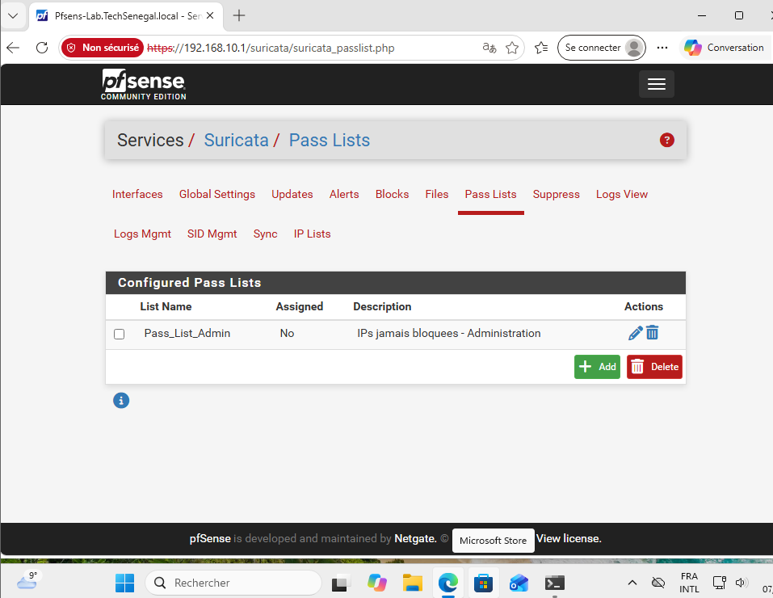

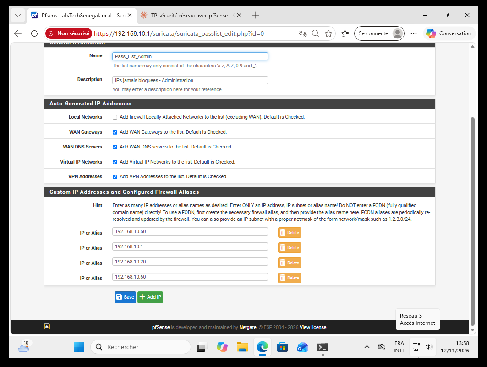

### Réglages de l'interface LAN

| Réglage | Valeur | Pourquoi |
|---|---|---|
| Block Offenders | Activé | Bloquer automatiquement les IP à l'origine d'alertes |
| Kill States | Activé | Couper aussi les connexions déjà ouvertes de l'IP bloquée |
| Which IP to Block | SRC | Bloquer la source, c'est-à-dire l'attaquant |
| Pass List | `Pass_List_Admins` | Ne jamais bloquer les IP de confiance |

Dans **Global Settings**, l'intervalle de retrait des hôtes bloqués est fixé à **1 heure** : une adresse peut être usurpée ou partagée
derrière un même NAT, un blocage ne doit donc pas durer indéfiniment.

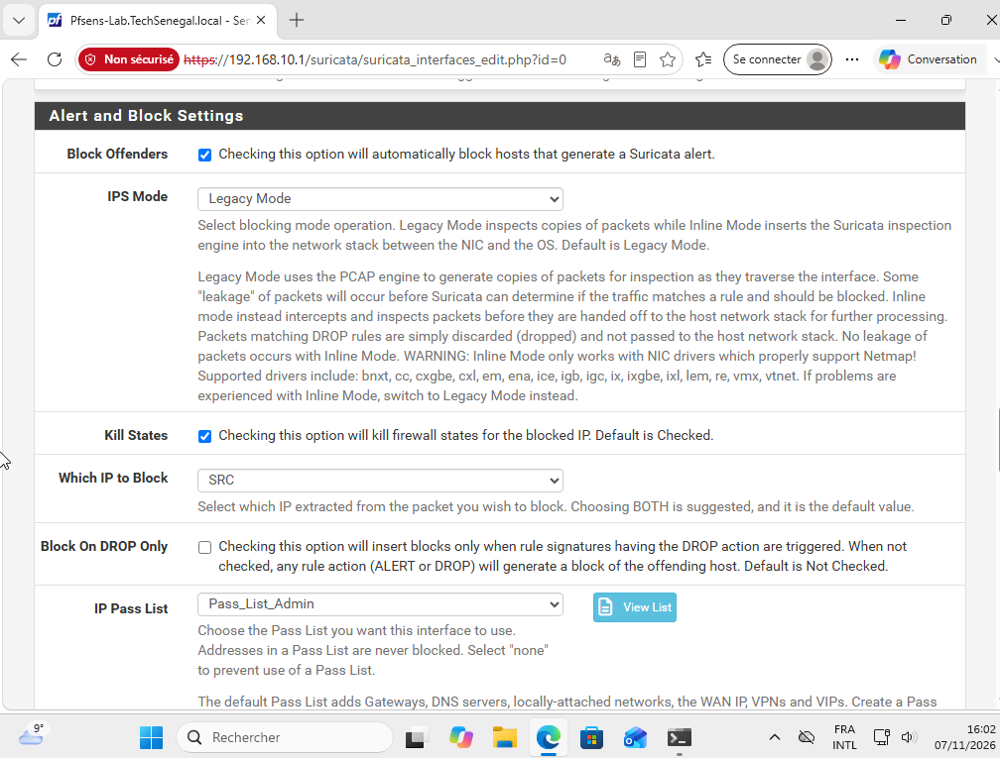

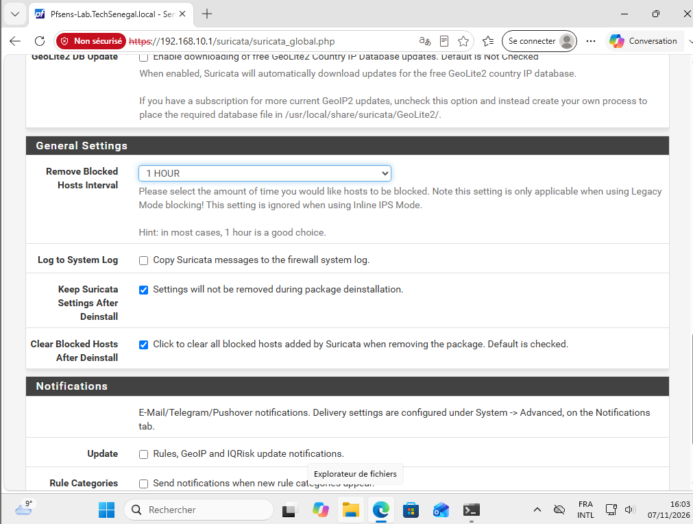

### Test : blocage d'un scan de ports

Depuis Kali : `sudo nmap -A -T4 192.168.10.20`. Après quelques secondes, l'adresse de Kali apparaît dans la table de blocage
(**Diagnostics > Tables > snort2c**, ou `pfctl -t snort2c -T show` dans le Command Prompt).

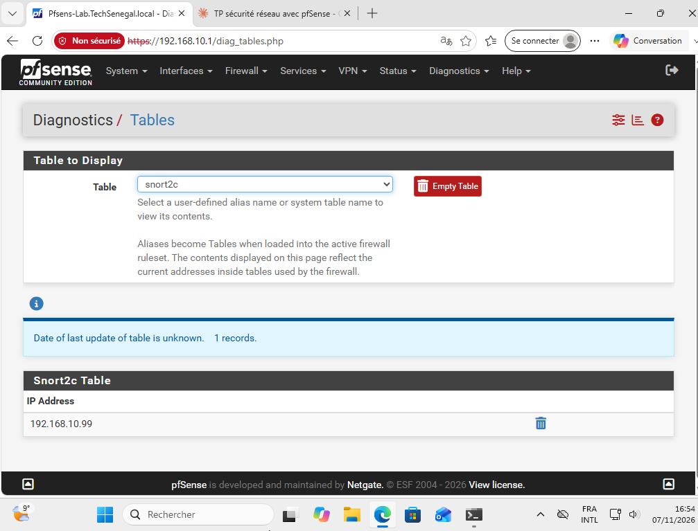

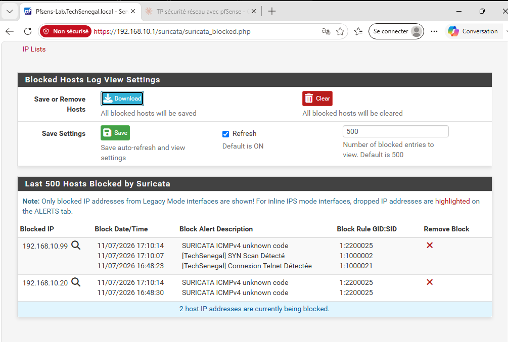

Commandes de gestion de la table :

```
pfctl -t snort2c -T show                    # lister les IP bloquées
pfctl -t snort2c -T delete 192.168.10.99    # débloquer une IP
pfctl -t snort2c -T flush                   # tout débloquer en urgence
```

### Observations sur le mode Legacy

- La **Pass List** protège bien le poste admin : 20 pings rapides depuis `192.168.10.50` ne l'ont jamais fait entrer dans la table.
- Kali est bien dans la table, mais il **joint toujours Ubuntu** (ports 22 et 80 ouverts dans un `nmap`, ping qui répond). La table
  `snort2c` est appliquée par le pare-feu, qui ne voit pas le trafic entre deux machines du **même segment**. L'adresse MAC affichée
  par `nmap` confirme que les deux machines sont sur le même réseau local.
  En production, on place les serveurs derrière une interface pfSense distincte (DMZ).
- Un **faux positif** est apparu : Ubuntu Server s'est retrouvé dans la table. Une règle intégrée de Suricata (`ICMPv4 unknown code`)
  avait réagi à ses réponses pendant un scan, et Suricata a bloqué la source de l'alerte. Correction : déblocage manuel,
  puis ajout de l'adresse à la Pass List.

## Partie 2 : mode Inline (NETMAP)

- `kldload netmap` répond que le module est déjà chargé ou intégré au noyau : NETMAP est disponible.
- Dans les réglages de l'interface LAN, **IPS Mode** passe de *Legacy* à **Inline**, puis Stop et Start de l'interface. Le LAN
  est resté fonctionnel.
- En mode inline, seule l'action **`drop`** supprime un paquet. Les trois règles à fort niveau de confiance passent de `alert` à `drop`,
  avec `rev` augmenté :

```
drop tcp any any -> $HOME_NET 22 (msg:"[TechSenegal] IPS - Brute Force SSH BLOQUÉ"; flow:to_server,established; content:"SSH"; depth:4; threshold:type threshold,track by_src,count 10,seconds 60; classtype:attempted-admin; sid:1000003; rev:3;)
drop tcp any any -> $HOME_NET any (msg:"[TechSenegal] IPS - SYN Scan BLOQUÉ"; flags:S,12; threshold:type threshold,track by_src,count 50,seconds 5; classtype:attempted-recon; sid:1000002; rev:3;)
drop tcp $HOME_NET any -> any 4444 (msg:"[TechSenegal] IPS - Trafic C2 BLOQUÉ"; flow:to_server,established; classtype:trojan-activity; priority:1; sid:1000005; rev:3;)
```

La règle C2 n'a **pas de seuil** : aucune connexion vers ce port n'est légitime ici, on bloque dès le premier paquet.

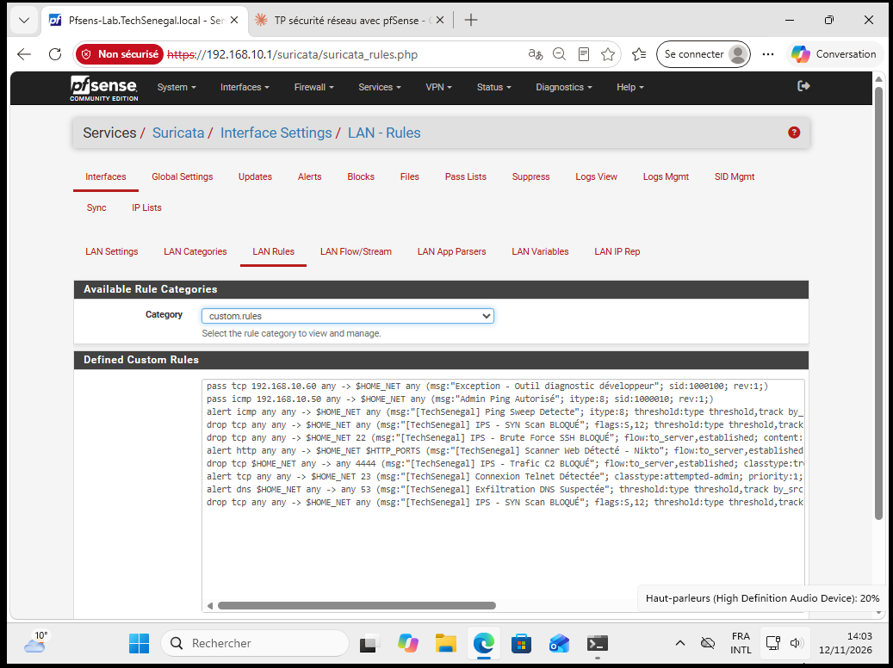

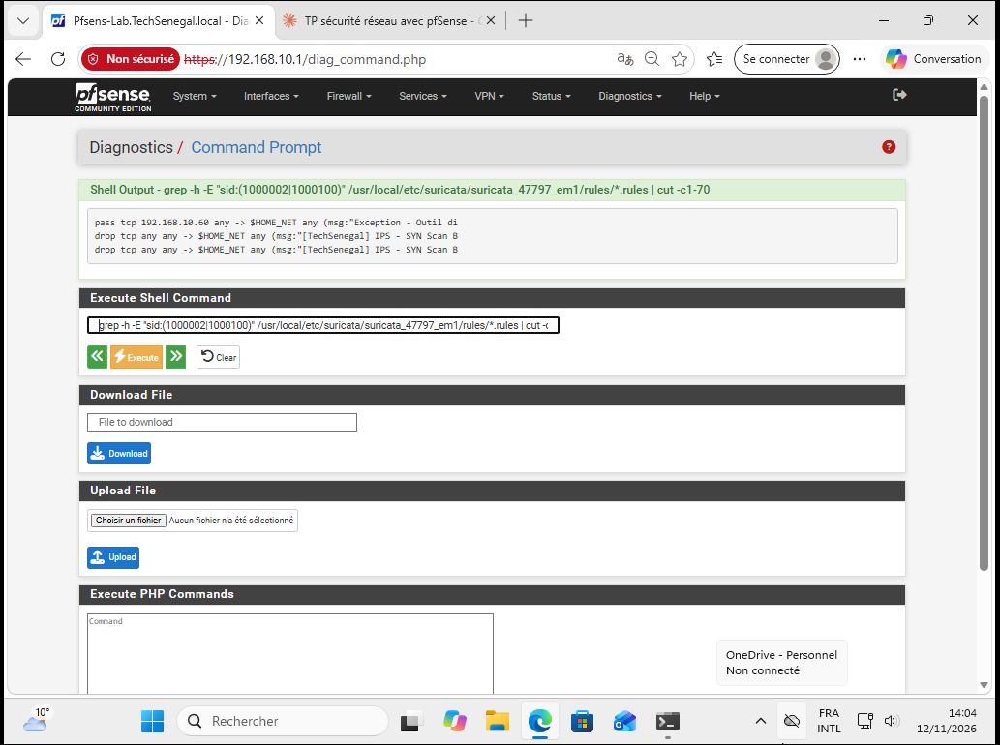

### Tests en mode inline

Le trafic légitime n'est pas perturbé : navigation, DNS et accès au serveur web depuis Windows, ping et une seule connexion SSH depuis Kali.

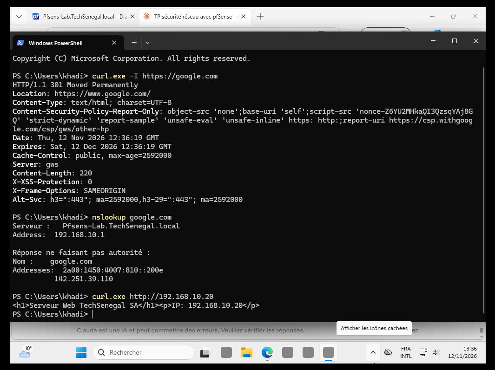

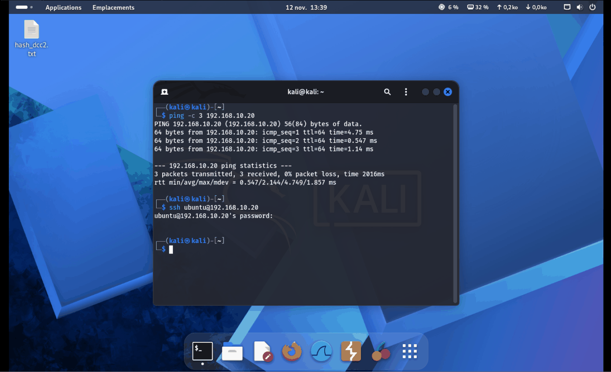

**Scan SYN** (`sudo nmap -sS -T4 --min-rate 50 192.168.10.20`) : l'entrée EVE passe de `"action":"allowed"` à **`"action":"blocked"`**.

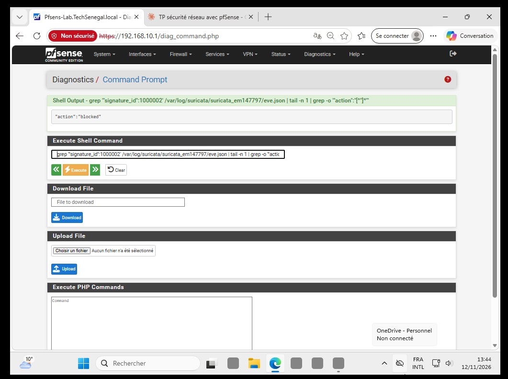

**Trafic C2** : Kali écoute avec `nc -lvp 4444`, Ubuntu tente `nc 192.168.10.99 4444`. La connexion ne s'établit jamais, et l'alerte
du SID 1000005 porte aussi `"action":"blocked"`. Sans IPS, ce premier paquet aurait établi la connexion.

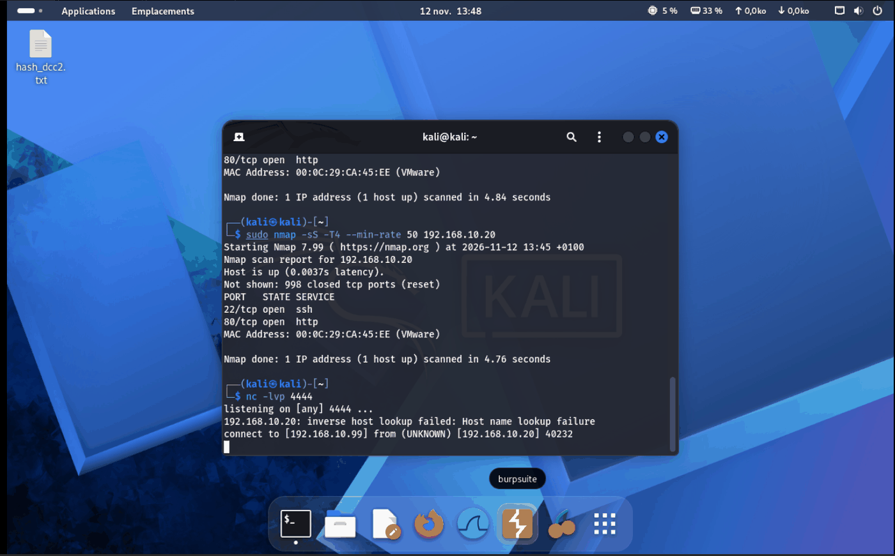

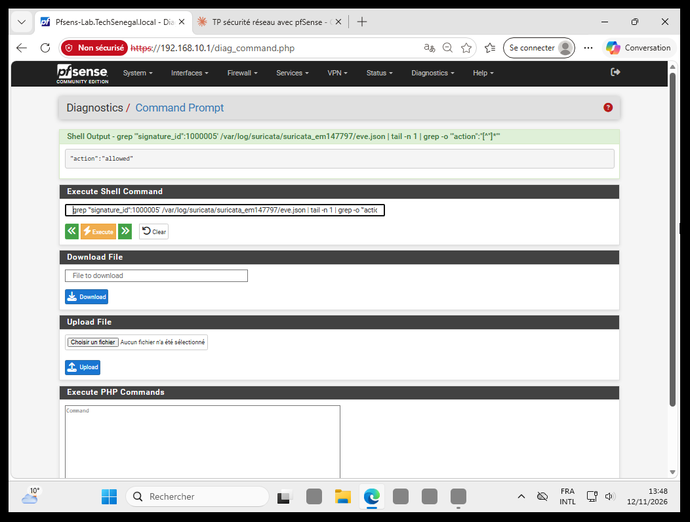

| | Mode IDS | Mode IPS inline |
|---|---|---|
| `alert.action` | `allowed` | `blocked` |
| Trafic réel | Continue | Stoppé |
| Résultat de `nmap` | Scan complet | Scan incomplet |

**Latence** : un ping de 100 paquets vers Ubuntu affiche une moyenne inférieure à 1 ms. Sur la même machine physique, l'impact de l'IPS
est négligeable ; en production, avec du matériel dédié et beaucoup de trafic, il serait mesurable.

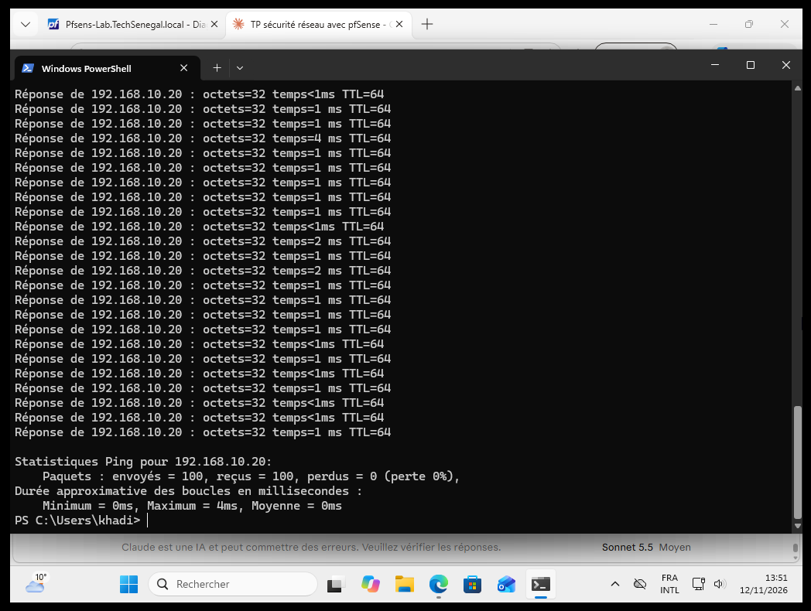

## Partie 3 : gérer un faux positif sans couper le service

Scénario : le poste d'un développeur (`192.168.10.60`), dont l'outil de diagnostic fait des scans, n'accède plus aux serveurs.
Le blocage a été simulé en ajoutant l'adresse à la table (`pfctl -t snort2c -T add 192.168.10.60`). Démarche :

1. **Diagnostiquer** : l'IP est-elle dans la table de blocage ?
2. **Identifier la règle** responsable en comptant les signatures par IP dans le journal EVE.
3. **Débloquer** immédiatement : `pfctl -t snort2c -T delete 192.168.10.60`.
4. **Corriger durablement**, au choix :
   - ajouter l'adresse à la **Pass List** (protège une machine précise) ;
   - **relever le seuil** de la règle SYN (de 20 SYN en 10 s à 50 SYN en 5 s : plus difficile à déclencher par accident) ;
   - ajouter une règle `pass` pour cette adresse, en tête de `custom.rules`.

Le compromis : la Pass List protège une machine, le seuil change la sensibilité pour tout le monde, mais un attaquant lent passe plus facilement.

## Partie 4 : confiner une machine suspecte

Scénario : Ubuntu Server (`192.168.10.20`) est peut-être compromis (connexions sortantes inconnues, trafic nocturne), mais il héberge un
service critique et ne peut pas être éteint. Trois règles le **confinent** : DNS et web sortants autorisés, tout le reste supprimé.
Les `pass` sont placés **avant** le `drop`.

```
pass udp 192.168.10.20 any -> $EXTERNAL_NET 53 (msg:"Confinement - DNS sortant autorisé"; sid:1000200; rev:1;)
pass tcp 192.168.10.20 any -> $EXTERNAL_NET [80,443] (msg:"Confinement - HTTP HTTPS sortant autorisé"; sid:1000201; rev:1;)
drop ip 192.168.10.20 any -> $EXTERNAL_NET any (msg:"[TechSenegal] Confinement - Trafic sortant BLOQUÉ"; classtype:policy-violation; sid:1000202; rev:1;)
```

Tests depuis Ubuntu :

| Test | Résultat |
|---|---|
| `nc -w 5 9.9.9.9 5555` (port quelconque) | Pas de connexion, alerte du SID 1000202 |
| `curl http://example.com` | Fonctionne (réponse HTTP reçue) |
| `nslookup google.com` | Fonctionne |

Le service reste utilisable, le trafic suspect est coupé. Un premier test vers `8.8.8.8` n'avait remonté aucune alerte 1000202 ;
je n'ai pas élucidé pourquoi (hypothèse : cette adresse est le DNS configuré dans pfSense et figure dans la Pass List). Le test
avec `9.9.9.9` a confirmé la règle. Le trafic DNS d'Ubuntu passe par pfSense (`192.168.10.1`), donc interne au réseau : la règle DNS
ne prouve pas grand-chose ici.

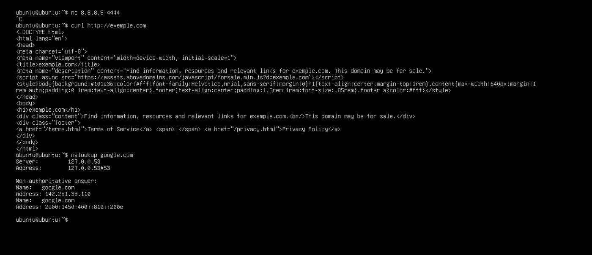

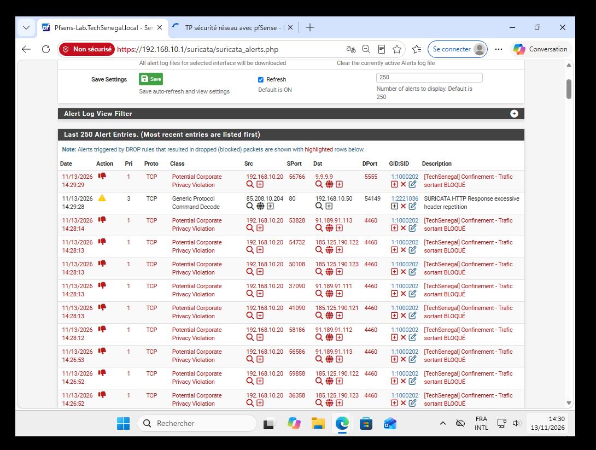

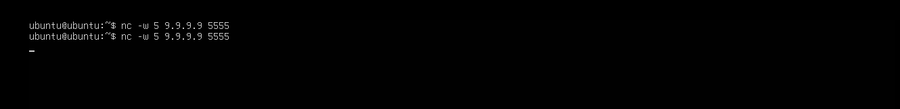

**Durée de confinement à recommander** : le temps de l'investigation, avec réévaluation quotidienne (de quelques jours au maximum).
**Suite de l'investigation** : capturer la mémoire et le disque, analyser les connexions sortantes et les processus actifs, relever
les comptes et fichiers modifiés, puis réinstaller la machine à partir d'une image saine.

## Problèmes rencontrés

| Problème | Cause | Correction |
|---|---|---|
| Kali jamais ajouté à la table de blocage | La Pass List cochait **Local Networks**, donc tout le LAN, Kali compris | Case décochée, Stop puis Start de Suricata |
| Ubuntu Server bloqué par erreur | Règle intégrée `ICMPv4 unknown code`, le blocage vise la source de **toute** alerte | Déblocage, puis adresse ajoutée à la Pass List |
| Kali bloqué dans la table mais toujours en contact avec Ubuntu | Même segment réseau, trafic qui ne traverse pas le pare-feu | Limite du lab, à noter ; les serveurs iraient derrière une DMZ |
| Deux règles `SYN Scan` avec le même SID | Ancienne ligne restée après le remplacement | Ancienne ligne supprimée, vérification par `grep -c` |
| Le Command Prompt n'apparaissait plus dans le menu de pfSense | Cause non identifiée | Page ouverte directement par son adresse (`/exec.php`), ou shell de la console (option 8) |

## À retenir

- Le blocage automatique agit sur la **source de n'importe quelle alerte**, y compris celles des règles intégrées : la Pass List
  est indispensable.
- Passer en IPS se fait **progressivement** : détecter, puis bloquer d'abord ce qui n'a aucun usage légitime.
- La position de Suricata dans la topologie détermine ce qu'il peut bloquer.
- Savoir **débloquer vite** et corriger la cause d'un faux positif est aussi important que savoir bloquer.
