# Authentification Kerberos et session SMB2 sur Active Directory

Lab réalisé les 23 et 24 octobre 2026 : analyse avec Wireshark de l'authentification d'un poste Windows 11 sur un domaine Active Directory, de l'ouverture de session jusqu'à l'accès à un partage de fichiers.

**Auteur :** Khadim Mbacké Thiao
**Domaine :** LAB.LOCAL
**Contrôleur de domaine :** DC-1.lab.local (192.168.10.2), qui joue aussi le rôle de DNS, de KDC et de serveur de fichiers
**Poste client :** kmt (192.168.10.6), compte khadim-mbacke.thiao@LAB.LOCAL
**Outils :** ipconfig, klist, dir, Wireshark

## Objectif

Comprendre ce qui se passe sur le réseau quand un utilisateur de domaine ouvre une session puis accède à un partage : quels messages Kerberos sont échangés, dans quel ordre, et comment le ticket est ensuite utilisé par SMB2.

## 1. Configuration réseau

Le poste est en IP fixe (192.168.10.6/24) et son seul DNS est le contrôleur de domaine. C'est indispensable : le client trouve le KDC grâce aux enregistrements SRV du DNS du domaine. Il n'y a pas de passerelle, le réseau est isolé.

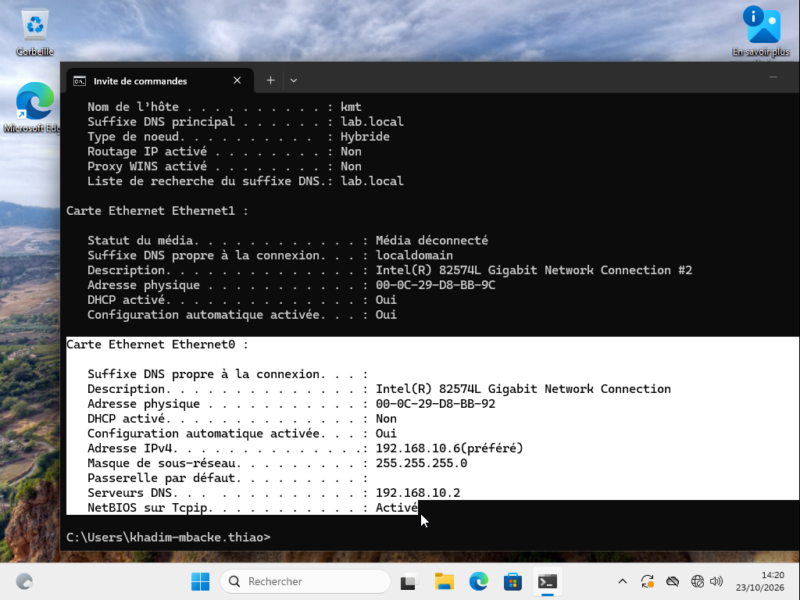
*ipconfig /all sur le poste client*

## 2. Tickets dans le cache (klist)

Après l'ouverture de session, `klist` affiche quatre tickets chiffrés en AES-256 : deux TGT pour `krbtgt/LAB.LOCAL` (valables 10 heures, renouvelables 7 jours), un ticket `cifs` pour les partages de fichiers et un ticket `ldap` pour l'annuaire.

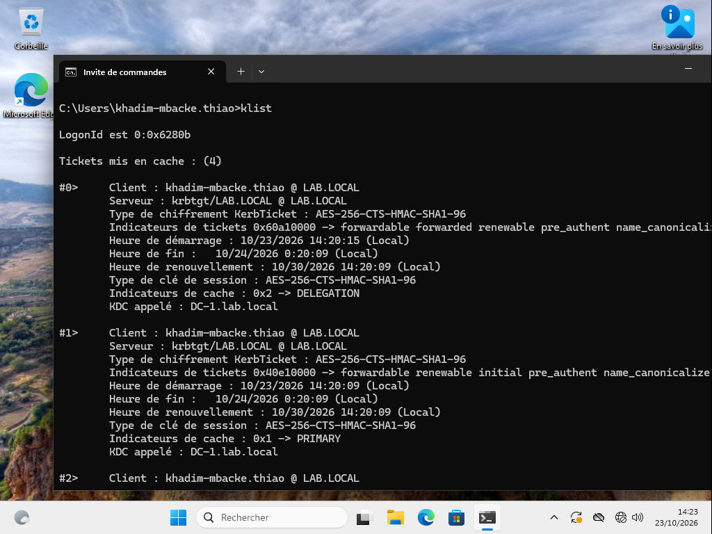
*klist le 23 octobre : les deux TGT*

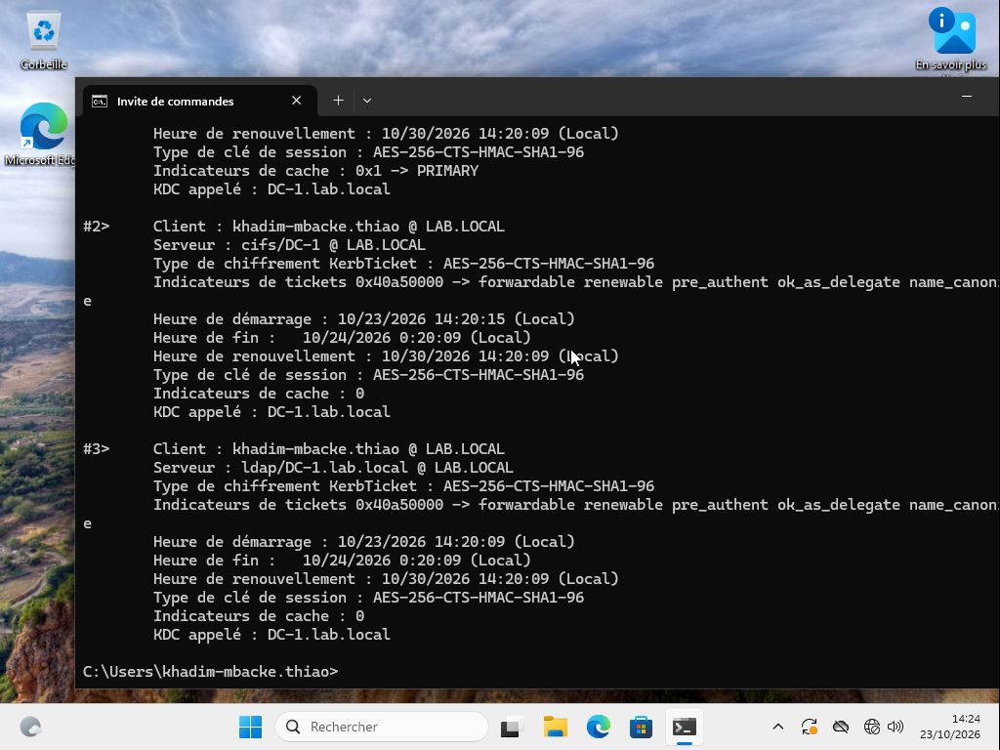
*klist le 23 octobre : tickets cifs et ldap*

Le lendemain, j'ai accédé au partage avec `dir \\DC-1.lab.local\COMMUN`. Un ticket `cifs/DC-1.lab.local` apparaît, avec le nom complet car c'est celui que j'ai saisi dans le chemin. Kerberos construit le nom du service à partir du nom tapé : avec une adresse IP, le client basculerait sur NTLM.

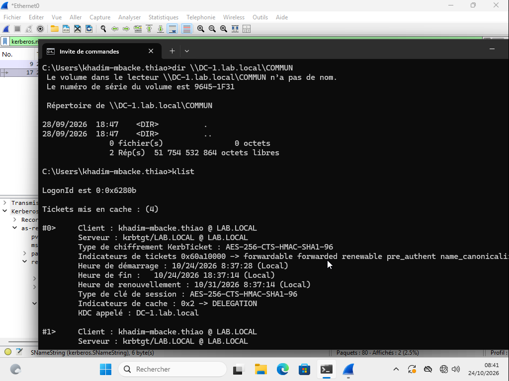
*Accès au partage puis klist*

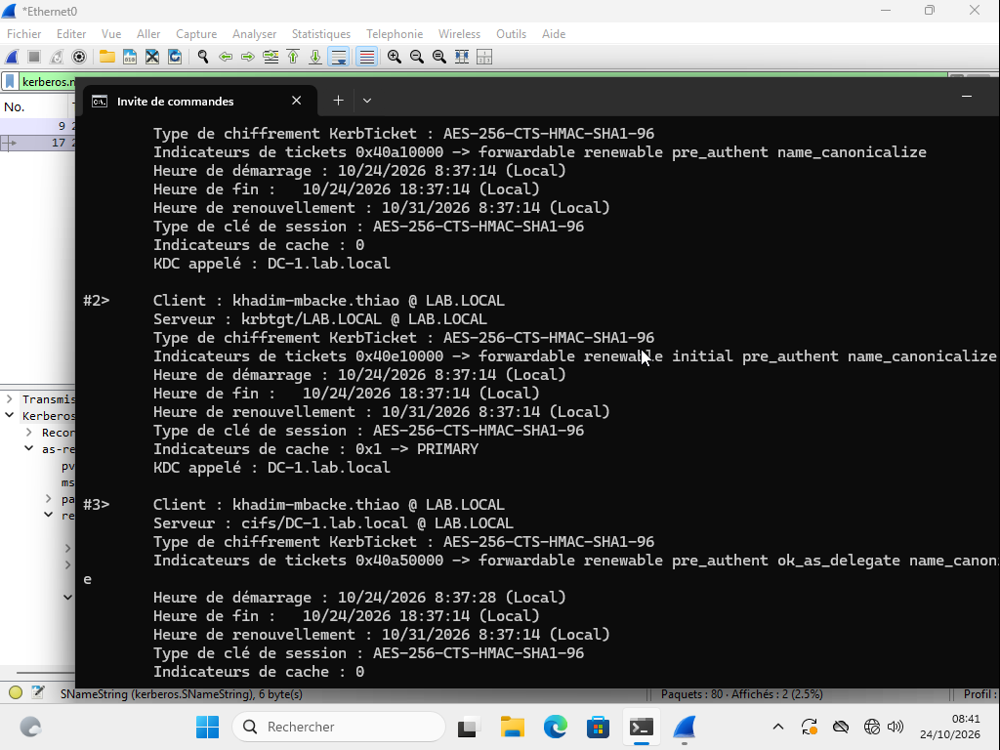
*Suite du klist du 24 octobre*

## 3. Analyse Wireshark

La capture, lancée avant l'ouverture de session, contient 80 paquets. Chaque étape est isolée avec le filtre `kerberos.msg_type`.

### AS-REQ et AS-REP : obtention du TGT

Filtres : `kerberos.msg_type == 10` puis `== 11`. Le client demande un ticket pour `krbtgt/LAB.LOCAL` et annonce qu'il gère AES-256 (18) et RC4 (23). Il réclame une validité jusqu'en 2100 : c'est le KDC qui la ramène à la politique du domaine, soit les 10 heures vues dans `klist`. Le paquet le plus long contient la pré-authentification : le client prouve qu'il connaît son secret sans envoyer son mot de passe. Le KDC répond avec le TGT chiffré en AES-256, lisible uniquement par lui.

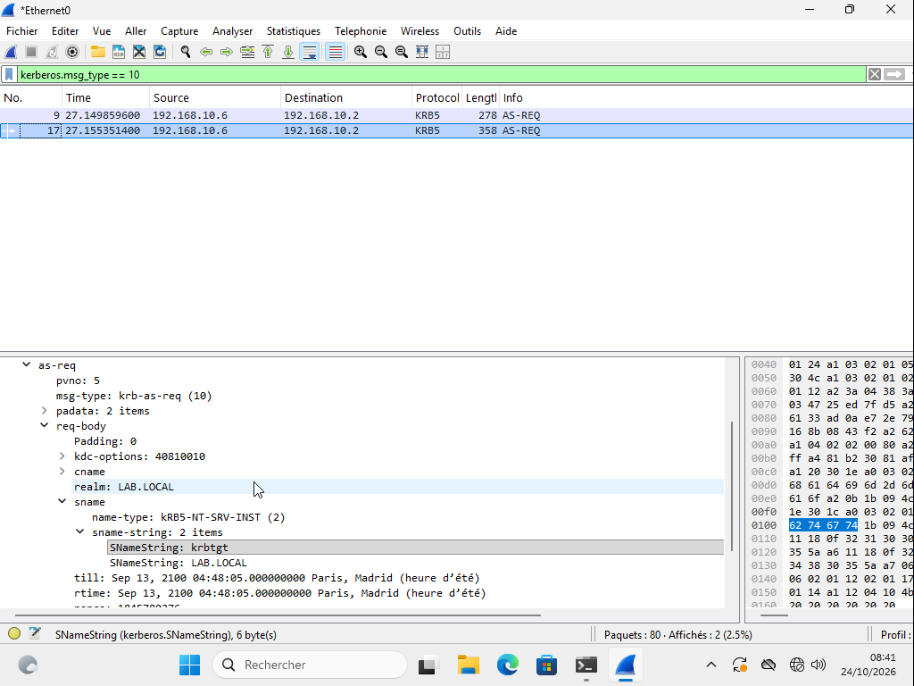
*AS-REQ : demande du TGT*

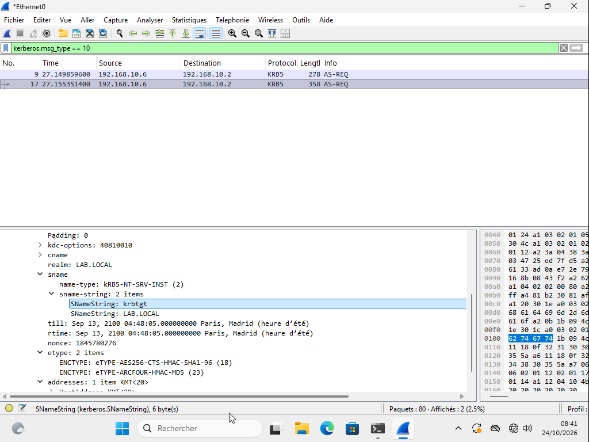
*AS-REQ : algorithmes proposés par le client*

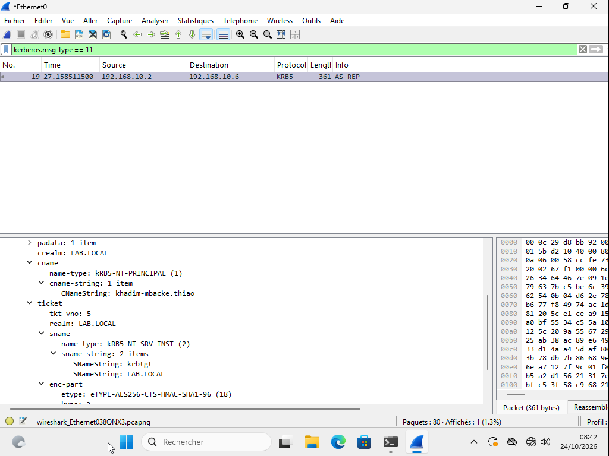
*AS-REP : le KDC renvoie le TGT*

### TGS-REQ et TGS-REP : obtention du ticket de service

Filtres : `kerberos.msg_type == 12` puis `== 13`. Le client présente son TGT et demande un ticket pour `cifs/DC-1.lab.local`. Le KDC répond avec un ticket chiffré en AES-256 avec la clé du compte machine DC-1 : le client ne peut pas le lire, il le transmet seulement au serveur.

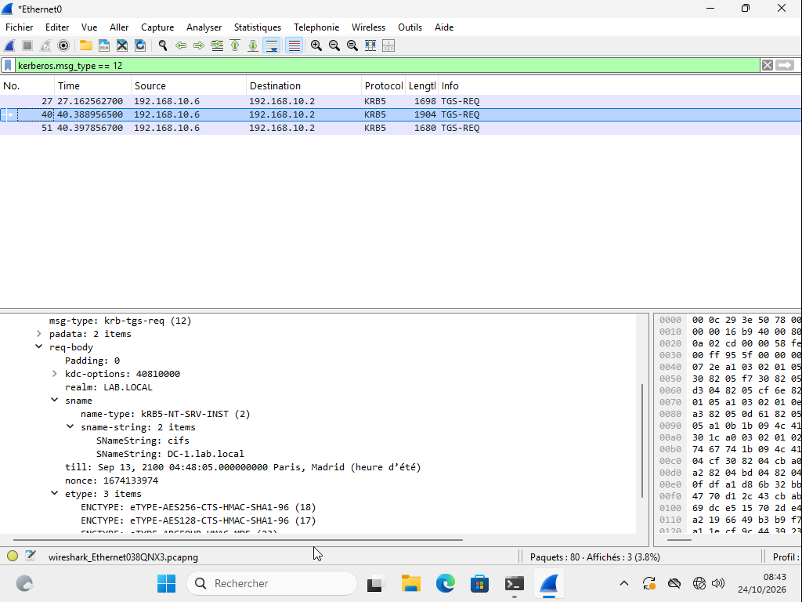
*TGS-REQ : demande du ticket cifs*

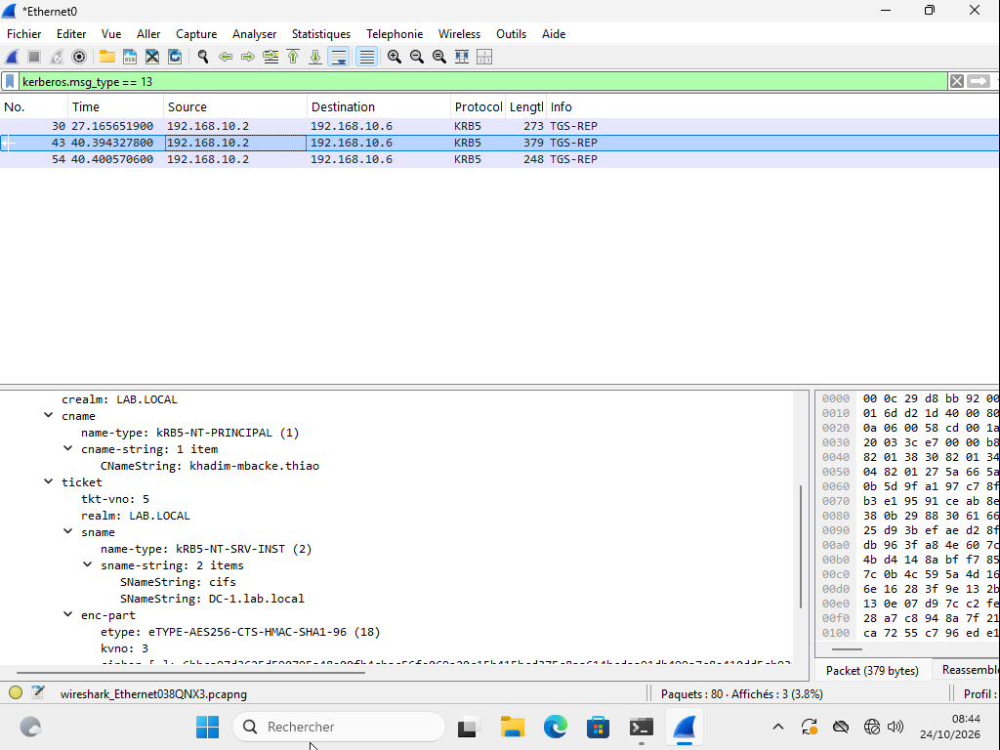
*TGS-REP : ticket de service émis*

### AP-REQ et AP-REP : ouverture de session SMB2

Filtres : `kerberos.msg_type == 14` puis `== 15`. Le client envoie le ticket dans le paquet SMB2 Session Setup Request, encapsulé par SPNEGO. Il propose Kerberos en premier et NTLM en dernier recours. Le serveur répond `accept-completed` avec un AP-REP : il a su déchiffrer le ticket, donc il prouve lui aussi son identité (authentification mutuelle).

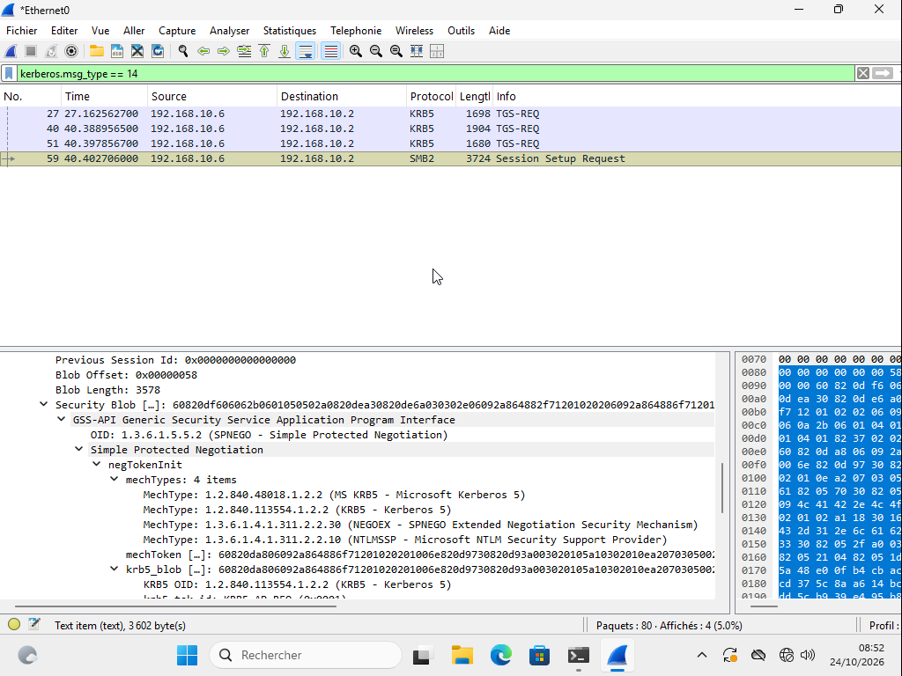
*AP-REQ dans la requête SMB2 Session Setup*

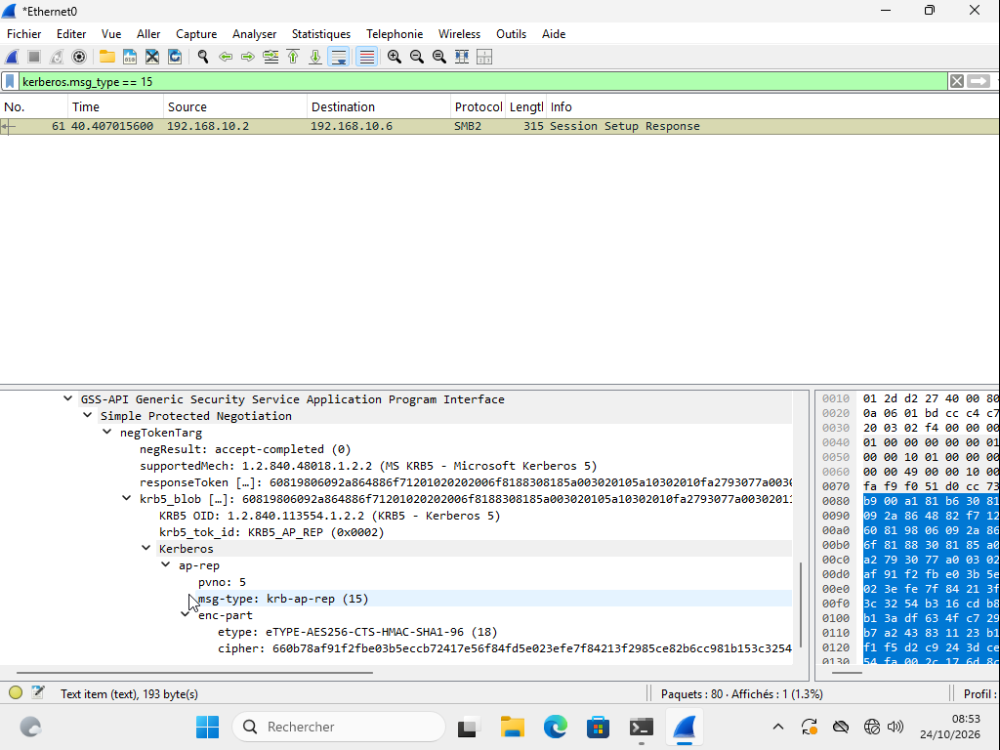
*AP-REP dans la réponse SMB2*

## Déroulement complet

1. Le poste interroge le DNS pour localiser le KDC.
2. **AS-REQ / AS-REP** : le client obtient son TGT.
3. **TGS-REQ / TGS-REP** : il obtient un ticket pour le service `cifs`.
4. **AP-REQ / AP-REP** : le serveur SMB2 valide le ticket, dans les deux sens.

Aucun mot de passe ne circule sur le réseau : seuls des tickets chiffrés sont échangés.

## Problèmes rencontrés et corrections

- **Deux AS-REQ pour une seule AS-REP** : explication la plus probable, Windows envoie d'abord une requête sans pré-authentification, le KDC répond par une erreur, puis une seconde requête passe avec la pré-authentification. Le filtre `kerberos.msg_type == 30` permettrait de le confirmer.
- **Le filtre `kerberos.msg_type == 14` affiche aussi des TGS-REQ** : elles contiennent elles-mêmes un AP-REQ imbriqué. Pour isoler l'échange SMB2, ajouter le filtre `smb2`.

## Compétences mobilisées

- Diagnostic DNS d'un client Active Directory
- Lecture du cache de tickets Kerberos avec `klist`
- Analyse de trafic avec Wireshark et filtres ciblés
- Compréhension de l'enchaînement AS, TGS et AP, et de son intégration dans SMB2
